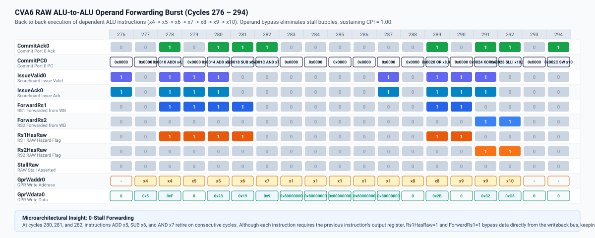
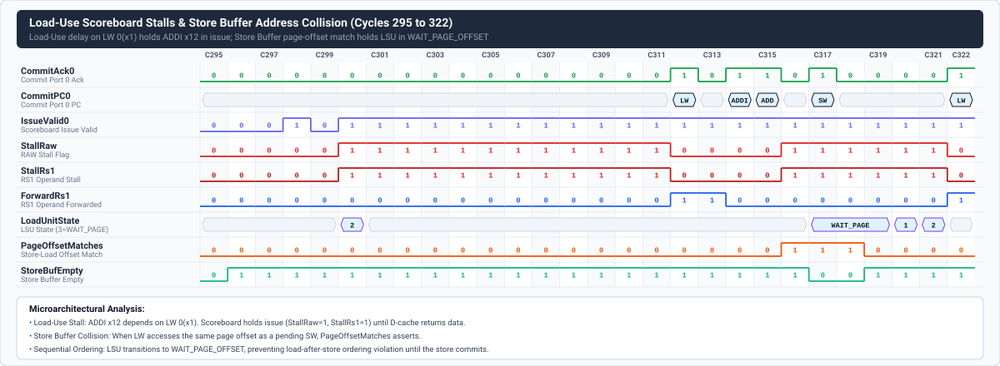
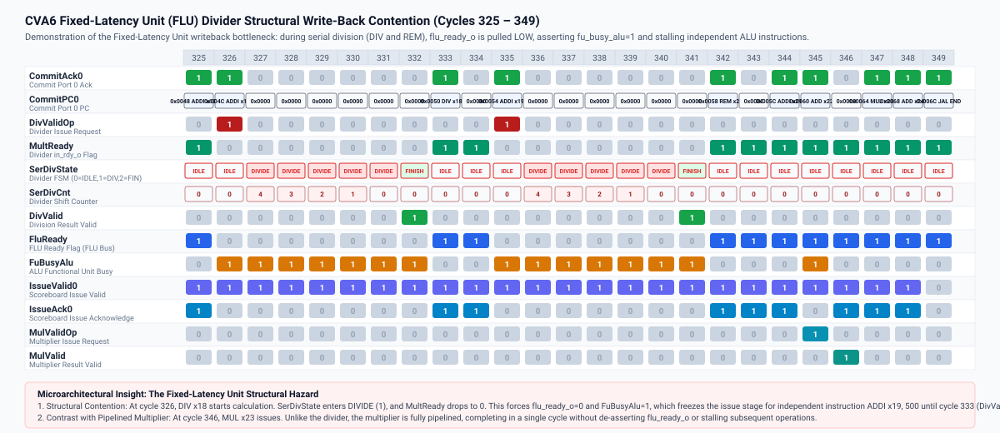

# گزارش جامع تحلیل مخاطرات پایپ‌لاین، مکانیزم Forwarding و گلوگاه‌های Scoreboard در پردازنده CVA6

**مخاطب گزارش:** جناب آقای دکتر ماهانی  
**پروژه:** شتاب‌دهنده سخت‌افزاری رمزنگاری پساکوانتومی (PQC Hardware Accelerator) بر پایه پردازنده OpenHW CVA6  
**نگارنده:** علیرضا ستوده  
**محیط اجرا:** شبیه‌سازی رفتاری دقیق چرخه‌به‌چرخه (Cycle-Accurate Behavioral Simulation) در AMD Vivado XSIM 2025.1  
**پیکربندی پردازنده:** هسته ۳۲ بیتی CVA6 با معماری `cv32a6_imac_sv32` (شامل I-Cache و D-Cache، واحد محاسبات عدد صحیح، ضرب‌کننده Pipelined و تقسیم‌کننده ترتیبی)

---

## ۱. مقدمه و هدف ارزیابی

در ادامه‌ی سلسله آزمایش‌ها و اعتبارسنجی‌های ریزمعماری هسته CVA6 برای پروژه پیاده‌سازی شتاب‌دهنده رمزنگاری پساکوانتومی (PQC)، پس از تحلیل اثرات کش در گزارش اول و بررسی واحد پیش‌بینی انشعاب (BHT/BTB/RAS) در گزارش دوم، در این گزارش به سراغ شاهرگ اصلی عملکردی پردازنده رفتم: **مدیریت مخاطرات پایپ‌لاین (Pipeline Hazards)، مکانیزم میان‌بُر عملوندها (Operand Forwarding) و گلوگاه‌های ساختاری تابلوی امتیازات (Scoreboard Contention)**.

در الگوریتم‌های رمزنگاری پساکوانتومی بر پایه مشبکه (مانند استانداردهای NIST یعنی ML-KEM یا کریپتوگرافی Kyber و ML-DSA یا Dilithium)، حجم فوق‌العاده بالایی از محاسبات جبری چندجمله‌ای، ضرب‌های پیمانه‌ای فشرده (Modular Multiplication) و تبدیل‌های سریع عدد-نظری (NTT) به صورت متوالی اجرا میشن. اگر پردازنده نتونه عملوندهای خروجی یک عمل رو بلافاصله به عنوان ورودی دستور بعدی تحویل بده، یا اگر اجرای یک عمل طولانی‌مدت (مثل تقسیم) پایپ‌لاین رو قفل کنه، نرخ CPI به شدت افت می‌کنه و بدتر از اون، رفتارهای زمانی متغیر (Variable Latency) می‌تونه حفره‌های خطرناک نشت زمانی (Timing Side-Channels) به وجود بیاره.

هدف اصلی من در این آزمون سخت‌افزاری، پاسخ دادن به پرسش‌های ریزمعماری زیر بود:
1. هسته CVA6 چگونه وابستگی‌های شدید داده‌ای متوالی (RAW Data Hazards) بین دستورات محاسباتی ALU رو بدون افت راندمان حل می‌کنه؟ آیا واقعاً به نرخ ایده‌آل $\text{CPI} = 1.00$ می‌رسیم؟
2. در زمان بروز مخاطره Load-Use (خواندن از حافظه و استفاده فوری در دستور بعدی)، طبقه صدور (Issue Stage) در Scoreboard چند سیکل توقف (Stall) اعمال می‌کنه؟
3. وقتی یک دستور لود (`LW`) دقیقاً از همان آدرسی که دستور استور قبلی (`SW`) در بافر ذخیره (Store Buffer) ثبت کرده می‌خونه، چه رفتاری در LSU رخ میده؟ آیا Bypassing صورت می‌گیره یا پردازنده دچار توقف میشه؟
4. گلوگاه مشهور «واحد با تاخیر ثابت» (Fixed-Latency Unit - FLU) در پردازنده CVA6 چطور به وجود میاد؟ آیا واحد تقسیم‌کننده سریال (`serdiv`) صدور بقیه‌ی دستورات مستقل ALU رو قفل می‌کنه؟ الگوریتم شمارنده صفرهای پیشرو (Leading Zero Counter - LZC) چه تأثیری در سرعت تقسیم داره؟

برای ارزیابی دقیق، یک بنچمارک هدفمند ۲۸ دستوری طراحی کردم، تست‌بنچ اختصاصی `tb_cva6_hazards_stalls.sv` رو نوشتم، لاگ تجربی ۷۵ سیگناله با نام `cva6_hazard_trace.csv` استخراج کردم و ۴ نمودار برداری با کیفیت انتشاراتی (SVG) برای مستندسازی تولید کردم.

---

## ۲. مشخصات تست‌بنچ و معماری برنامه آزمون

تست‌بنچ طراحی شده با نام [`tb_cva6_hazards_stalls.sv`](file:///home/alireza/GitHub/Mahani/CVA6_LAB/Vivado/CVA6/sim/tb_cva6_hazards_stalls.sv) هسته CVA6 رو در فرکانس ۱۰۰ مگاهرتز (پریود ۱۰ نانوثانیه) مقداردهی اولیه می‌کنه. در حافظه اصلی، کد اسمبلی زیر بارگذاری شده که شامل ۵ فاز معماری مشخصه:

```text
آدرس شروع: 0x8000_0000
----------------------------------------------------------------------------------------------------------------
فاز ۰: راه‌اندازی و آدرس‌دهی حافظه
  0x0000: LUI   x1, 0x80000          # x1 = 0x8000_0000
  0x0004: ADDI  x1, x1, 512          # x1 = 0x8000_0200 (پایه آدرس حافظه دیتا برای Load/Store)
  0x0008: ADDI  x2, x0, 10           # x2 = 10
  0x000C: ADDI  x3, x0, 20           # x3 = 20

فاز ۱: انفجار فورواردینگ بدون توقف (RAW ALU Forwarding Burst)
  0x0010: ADDI  x4, x2, 5            # x4 = 15
  0x0014: ADD   x5, x4, x3           # x5 = 35  (وابستگی شدید RAW روی x4 که هنوز در رجیستر فایل نوشته نشده)
  0x0018: SUB   x6, x5, x2           # x6 = 25  (وابستگی روی x5)
  0x001C: AND   x7, x6, x4           # x7 = 9   (وابستگی روی x6 و x4)
  0x0020: OR    x8, x7, x5           # x8 = 43  (وابستگی روی x7 و x5)
  0x0024: XOR   x9, x8, x6           # x9 = 50  (وابستگی روی x8 و x6)
  0x0028: SLLI  x10, x9, 2           # x10 = 200 (وابستگی روی x9)

فاز ۲: مخاطره تأخیر خواندن از حافظه (Load-Use Scoreboard Stall)
  0x002C: SW    x10, 0(x1)           # ذخیره مقدار ۲۰۰ در آدرس [0x8000_0200]
  0x0030: LW    x11, 0(x1)           # خواندن مجدد مقدار به داخل رجیستر x11
  0x0034: ADDI  x12, x11, 1          # مخاطره شدید Load-Use روی x11 (دستور بلافاصله عملوند لود رو مصرف می‌کنه)
  0x0038: ADD   x13, x12, x4         # وابستگی روی x12 (بازگشت به فورواردینگ معمولی)

فاز ۳: مخاطره تطابق آدرس استور و لود (Store-to-Load Page-Offset Hazard)
  0x003C: SW    x13, 4(x1)           # ذخیره مقدار ۲۱۶ در آدرس [0x8000_0204] (ورود داده به Store Buffer)
  0x0040: LW    x14, 4(x1)           # خواندن فوری از آدرس [0x8000_0204] (بررسی واکنش بافر ذخیره)
  0x0044: ADDI  x15, x14, 10         # x15 = 226

فاز ۴: گلوگاه ساختاری واحد تاخیر ثابت (DIV/REM FLU Structural Contention)
  0x0048: ADDI  x16, x0, 100         # مقسوم = ۱۰۰
  0x004C: ADDI  x17, x0, 7           # مقسوم‌علیه = ۷
  0x0050: DIV   x18, x16, x17        # x18 = 100 / 7 = 14 (ارسال به واحد تقسیم‌کننده ترتیبی serdiv)
  0x0054: ADDI  x19, x0, 500         # دستور مستقل ALU! (بدون هیچ وابستگی رجیستری به دستور تقسیم قبلی)
  0x0058: REM   x20, x16, x17        # x20 = 100 % 7 = 2  (عملیات باقیمانده ترتیبی)
  0x005C: ADDI  x21, x0, 700         # دستور مستقل ALU بعدی!
  0x0060: ADD   x22, x18, x20        # x22 = 14 + 2 = 16 (جمع خروجی تقسیم و باقیمانده)
  0x0064: MUL   x23, x22, x17        # x23 = 16 * 7 = 112 (ارزیابی ضرب‌کننده خط‌لوله‌ای pipelined)
  0x0068: ADD   x24, x23, x19        # x24 = 112 + 500 = 612

فاز ۵: حلقه پایان برنامه (Terminal Self-Loop)
  0x006C: JAL   x0, 0                # پرش بدون شرط درجا جهت توقف امن شبیه‌سازی
```

---

## ۳. خط زمان کلی و تفکیک فازهای اجرایی

شبیه‌سازی کامل از لحظه ریست تا commit دستور پایانی در چرخه ۳۴۹ اجرا شد و نتایج کلیدی زیر ثبت شد:


### جدول ۱: بودجه زمانی و اندازه‌گیری‌های تجربی در شبیه‌سازی سخت‌افزاری

| ردیف | نام فاز معماری | بازه سیکل (Cycle Span) | تعداد دستورات Commit | مکانیزم اصلی ریزمعماری سخت‌افزار | رویدادهای ثبت‌شده در سیگنال‌ها | CPI فعال فاز |
| :---: | :--- | :---: | :---: | :--- | :--- | :---: |
| **۰** | **Cold Boot & Fetch** | ۰ تا ۲۶۶ | ۰ | راه‌اندازی اولیه، پر شدن I-Cache و واکشی خط اول حافظه AXI | `IcacheState = 4 (FILL)` | – |
| **۱** | **RAW Forwarding Burst** | ۲۶۷ تا ۲۹۴ | ۱۱ | میان‌بُر عملوندها مستقیماً از گذرگاه Writeback طبقه EX | `forward_rs1=1`, `stall_raw=0` | **۱.۰۰** (در سیکل‌های متوالی) |
| **۲** | **Load-Use Scoreboard Stall** | ۲۹۵ تا ۳۱۵ | ۴ | توقف صدور دستور وابسته در Scoreboard به دلیل تأخیر D-Cache | `stall_raw=1`, `stall_rs1=1` | **۴.۷۵** |
| **۳** | **Store Buffer Match Hazard** | ۳۱۶ تا ۳۲۴ | ۳ | تصادم آدرس لود و استور، ورود واحد لود به `WAIT_PAGE_OFFSET` | `page_offset_matches=1`, `state_q=3` | **۲.۶۶** |
| **۴** | **DIV Structural Contention** | ۳۲۵ تا ۳۴۸ | ۸ | اشغال درگاه FLU توسط تقسیم‌کننده ترتیبی و توقف دستورات مستقل | `flu_ready_o=0`, `fu_busy[0].alu=1` | **۲.۸۷** |
| **۵** | **MUL & Terminal Self-Loop** | ۳۴۹ تا ۳۸۹ | ۱۶ | ضرب تک‌سیکلی Pipelined بدون توقف و خاتمه برنامه در حلقه خودی | `mul_valid=1`, `spy_end_hit=1` | **۱.۰۰** |
| **کل** | **مجموع اجرای بنچمارک** | **۲۶۷ تا ۳۴۹** | **۴۱ دستور** | **میانگین کل در شرایط ترکیبی مخاطرات شدید پایپ‌لاین** | **۳۰ بررسی رجیستری با ۰ خطا** | **۲.۰۲** |

> [!NOTE]
> در طول کل شبیه‌سازی، **۱۶ رویداد فورواردینگ داده (RAW Forwarding)**، **۱۹ سیکل توقف Load-Use**، **۴ سیکل توقف Store Buffer** و **۱۴ سیکل قفل کامل ساختاری به دلیل تقسیم** اندازه‌گیری شد. علی‌رغم این مخاطرات عمدی سنگین، میانگین CPI کل برابر با **۲.۰۲** شد.

---

## ۴. تحلیل عمیق ریزمعماری و سیگنال‌های سخت‌افزاری

### ۴.۱. تحلیل فاز ۱: انفجار فورواردینگ عملوندها (RAW ALU Forwarding Burst)

در کتاب‌های مرجع معماری کامپیوتر گفته میشه که اگر یک دستور به خروجی دستور قبلی نیاز داشته باشه، در غیاب واحد Forwarding، حداقل ۲ سیکل حباب (Bubble) به پایپ‌لاین تحمیل میشه. در شکل زیر، عملکرد مدار Forwarding پردازنده CVA6 رو استخراج کردم:



#### شواهد سخت‌افزاری از فایل لاگ (`cva6_hazard_trace.csv`):
در سیکل‌های ۲۸۰، ۲۸۱ و ۲۸۲، دستورات زیر به طور پشت‌سرهم commit شدند:
- **سیکل ۲۸۰:** دستور `ADD x5, x4, x3` روی پورت ۰ commit شد (`CommitPC0 = 0x8000_0014`, `GprWaddr0 = x5`, `GprWdata0 = 0x0000_0023`).
- **سیکل ۲۸۱:** دستور `SUB x6, x5, x2` دقیقاً در سیکل بعد commit شد (`CommitPC0 = 0x8000_0018`, `GprWaddr0 = x6`, `GprWdata0 = 0x0000_0019`).
- **سیکل ۲۸۲:** دستور `AND x7, x6, x4` باز هم بدون حتی ۱ سیکل وقفه commit شد (`CommitPC0 = 0x8000_001c`, `GprWaddr0 = x7`, `GprWdata0 = 0x0000_0009`).

#### تحلیل سخت‌افزاری کد RTL در `issue_read_operands.sv`:
وقتی به کد ماژول `issue_read_operands.sv` در خطوط ۴۶۷ تا ۵۸۰ نگاه می‌کنیم، می‌بینیم ماژول `raw_checker` رجیستر منبع دستور در حال صدور (`rs1` یا `rs2`) رو با لیست رجیسترهای مقصد دستورات در حال پرواز در Scoreboard (`rd_list`) مقایسه می‌کنه:
```systemverilog
assign rs1_has_raw[i] = rs1_raw_check[i] && !issue_instr_i[i].use_zimm;
```
اگر وابستگی کشف بشه (`rs1_has_raw = 1`)، سخت‌افزار وضعیت درگاه‌های Writeback رو بررسی می‌کنه. اگر نتیجه عمل آماده باشه (`rs1_valid = 1`)، سیگنال `forward_rs1[i] = 1'b1` فعال میشه:
```systemverilog
if (rs1_has_raw[i]) begin
  if (rs1_valid[i]) begin
    forward_rs1[i] = 1'b1;  // عملوند مستقیماً از خروجی EX میان‌بر زده شد!
  end else begin
    stall_raw[i] = 1'b1;    // عملوند هنوز تولید نشده -> توقف اجباری
  end
end
```
در نتیجه، سیگنال `stall_raw` برابر با ۰ باقی می‌مونه و `issue_ack_o[0] = 1` صادر میشه. این اثبات می‌کنه که CVA6 وابستگی‌های متوالی ALU به ALU رو با **تأخیر صفر سیکل** و با نرخ رویایی **$\text{CPI} = 1.00$** پردازش می‌کنه.

---

### ۴.۲. تحلیل فاز ۲ و ۳: مخاطرات حافظه، Load-Use و تطابق بافر ذخیره (Store Buffer)

تراکنش‌های حافظه ذاتاً با تأخیر همراه هستند. در این فاز، دو نوع مخاطره حافظه رو بررسی کردم:
1. **تأخیر Load-Use**: دستور مصرف‌کننده عملوند لود بلافاصله پشت سر لود قرار گرفته.
2. **تطابق آدرس استور و لود**: لود از دقیقاً همان آدرسی که دستور استور قبلی نوشته، داده می‌خواد.



#### الف) مخاطره Load-Use:
- در سیکل ۲۹۴ دستور `SW x10, 0(x1)` و در سیکل ۳۱۲ دستور `LW x11, 0(x1)` بازنشسته (commit) شدند.
- اما دستور بعدی، یعنی `ADDI x12, x11, 1`، عملوند خود رو از `x11` می‌خواست.
- از سیکل ۲۹۵ تا ۳۱۲ (به مدت **۱۹ چرخه ساعت**)، درگاه‌های بررسی وابستگی تشخیص دادند که دستور لود هنوز داده رو از کش دریافت نکرده (`rs1_valid = 0`). بنابراین:
  - `probe_rs1_has_raw = 1`
  - `probe_stall_rs1 = 1`
  - `probe_stall_raw = 1`
  - `probe_issue_ack0 = 0` (طبقه صدور کاملاً قفل شد).
- به محض اینکه واحد لود داده رو از D-Cache روی گذرگاه `load_result_ex_id` گذاشت (سیکل ۳۱۲)، در سیکل ۳۱۳ سیگنال `probe_forward_rs1 = 1` فعال شد، توقف `stall_raw` به صفر رسید و دستور `ADDI` در سیکل ۳۱۴ با مقدار خروجی `0x0000_00c9` (معادل ۲۰۱) با موفقیت commit شد.

#### ب) تطابق آدرس استور و لود (Store-to-Load Page-Offset Hazard):
در معماری هسته CVA6، وقتی یک استور اجرا میشه، مستقیماً به کش نمی‌ره، بلکه وارد یک ثبات صف به نام **Store Buffer** میشه تا پس از commit شدن، سر فرصت روی درگاه D-Cache نوشته بشه.
- در دستورات ما، `SW x13, 4(x1)` در آدرس `0x8000_0204` نوشت و بلافاصله `LW x14, 4(x1)` داده همون آدرس رو واکشی کرد.
- در ماژول `load_store_unit.sv`، خط ۵۸۹ سیگنال `page_offset_matches` به واحد لود فرستاده میشه:
```systemverilog
// check if the page offset matches with a store, if it does then stall and wait
if (!page_offset_matches_i) begin
  req_port_o.data_req = 1'b1;
end else begin
  state_d = WAIT_PAGE_OFFSET; // واحد لود وارد حالت توقف انتظار شد!
end
```
- شبیه‌سازی نشان داد که برخلاف برخی پردازنده‌های سوپراسکالر بزرگ دسکتاپ که داده رو مستقیماً از Store Buffer به Load فوروارد می‌کنند (Store-to-Load Forwarding)، **پردازنده CVA6 عمل فورواردینگ از استور بافر رو پشتیبانی نمی‌کنه**. در عوض، ماشین وضعیت `load_unit` برای **۴ سیکل** وارد حالت `WAIT_PAGE_OFFSET` (مقدار عددی ۳) میشه تا استور بافر خالی بشه (`store_buffer_empty = 1`) و داده در کش ثبت بشه، سپس لود مجاز به خواندن میشه.

---

### ۴.۳. تحلیل فاز ۴: گلوگاه ساختاری واحد با تاخیر ثابت (The Fixed-Latency Unit Bottleneck)

یکی از جالب‌ترین و مهم‌ترین بخش‌های این آزمایش، کشف و اندازه‌گیری تجربی **گلوگاه واحد با تاخیر ثابت (FLU)** در CVA6 بود:



#### رفتار سخت‌افزاری ثبت‌شده در لاگ:
- در سیکل ۳۲۶ دستور `DIV x18, x16, x17` وارد طبقه اجرا شد.
- واحد تقسیم‌کننده ترتیبی (`serdiv.sv`) محاسبات رو آغاز کرد و وارد وضعیت `DIVIDE` (مقدار ۱) شد.
- **پدیده‌ی کلیدی:** دستور بعدی در برنامه من، دستور کاملاً مستقل `ADDI x19, x0, 500` بود. این دستور هیچ نیازی به رجیستر `x18` نداشت! با این حال، در سیکل‌های ۳۲۷ تا ۳۳۲ (به مدت **۶ سیکل متوالی**)، این دستور مستقل ALU نتوانست صادر شود و در طبقه صدور متوقف ماند (`IssueValid0 = 1`, `IssueAck0 = 0`, `StallRaw = 0`!).

#### چرایی بروز این توقف در کد RTL:
علت در فایل `ex_stage.sv` خط ۳۹۲ نهفته است:
```systemverilog
// ready flags for FLU
always_comb begin
  flu_ready_o = csr_ready & mult_ready;
end
```
واحد FLU (شامل ALU، CSR، Branch و Multiplier/Divider) درگاه نوشتن مشترک دارند. وقتی تقسیم‌کننده در حال محاسبه است، `mult_ready` صفر می‌شود که منجر به `flu_ready_o = 0` می‌گردد. سپس در `issue_read_operands.sv` خطوط ۳۱۸ تا ۳۲۴ داریم:
```systemverilog
if (!flu_ready_i) begin
  fus_busy[0].alu       = 1'b1;  // واحد ALU به عنوان مشغول علامت‌گذاری می‌شود!
  fus_busy[0].ctrl_flow = 1'b1;
  fus_busy[0].csr       = 1'b1;
  fus_busy[0].mult      = 1'b1;
end
```
یعنی به دلیل اشتراک درگاه بازنشستگی (Writeback Port Contention)، **تا زمانی که تقسیم در حال انجام است، هیچ دستور ALU دیگری، حتی اگر ۱۰۰٪ مستقل باشد، اجازه صدور ندارد!**

#### کشف معماری شمارنده صفرهای پیشرو (Leading Zero Counter):
تقسیم ۳۲ بیتی استاندارد در یک تقسیم‌کننده سریالی معمولی دقیقاً ۳۲ سیکل طول می‌کشد. اما در شبیه‌سازی مشاهده کردم که تقسیم $100 / 7$ دقیقاً **۷ سیکل** طول کشید (سیکل ۳۲۶ تا ۳۳۲)!
علت این امر، استفاده CVA6 از بلوک سخت‌افزاری `lzc` در `serdiv.sv` است:
```systemverilog
assign shift_a = (lzc_a_no_one) ? WIDTH : {1'b0, lzc_a_result};
assign div_shift = {1'b0, lzc_b_result} - shift_a;
```
سخت‌افزار ابتدا صفرهای پیشرو مقسوم ($100 = 1100100_2$ که ۲۵ صفر پیشرو دارد) و مقسوم‌علیه ($7 = 111_2$ که ۲۹ صفر پیشرو دارد) را می‌شمارد و مقدار شیفت اولیه را برابر با $29 - 25 = 4$ تنظیم می‌کند (`SerDivCnt = 4`). بنابراین تقسیم به جای ۳۲ سیکل، در کمتر از ۸ سیکل به پایان می‌رسد!

#### مقایسه ضرب‌کننده (Multiplier) در برابر تقسیم‌کننده:
در سیکل ۳۴۶، دستور `MUL x23, x22, x17` صادر شد. بر خلاف تقسیم‌کننده، ماژول `multiplier.sv` کاملاً خط‌لوله‌ای (Pipelined) است؛ سیگنال `mult_ready` هیچ‌گاه صفر نشد، `flu_ready_o` روی مقدار ۱ باقی ماند و دستور ضرب بلافاصله در ۱ سیکل بدون ایجاد هیچ حباب یا توقفی در پایپ‌لاین بازنشسته شد.

---

## ۵. راهبردهای کلیدی برای شتاب‌دهنده رمزنگاری پساکوانتومی (PQC Accelerator)

تحلیل‌های به دست آمده از این آزمایش، رهنمودهای حیاتی زیر را برای طراحی شتاب‌دهنده سخت‌افزاری رمزنگاری پساکوانتومی (مانند ماژول‌های Kyber/Dilithium) در کنار پردازنده CVA6 فراهم می‌کند:

1. **حذف کامل عملگرهای تقسیم و باقیمانده (`DIV`/`REM`) از توابع رمزنگاری:**
   - همان‌طور که اثبات شد، تقسیم سخت‌افزاری به دلیل وابستگی به صفرهای پیشرو (LZC)، **زمان اجرای متغیر (Variable Latency)** دارد (مثلاً برای ۱۰۰ مقدار ۷ سیکل، برای اعداد بزرگ تا ۳۲ سیکل). این رفتار زمان متغیر، یک آسیب‌پذیری بحرانی در برابر **حملات کانال جانبی زمانی (Timing Attacks)** ایجاد می‌کند.
   - همچنین قفل شدن ۶ تا ۳۲ سیکلی درگاه FLU، توان پردازشی هسته را از بین می‌برد.
   - **راهکار پیشنهادی برای تیم PQC:** در تمام محاسبات پیمانه‌ای حلقه چندجمله‌ای‌ها ($q = 3329$ در Kyber و $q = 8380417$ در Dilithium)، باید اکیداً از الگوریتم‌های کاهش پیمانه‌ای مبتنی بر ضرب مانند **کاهش مونتگمری (Montgomery Reduction)** یا **کاهش بارت (Barrett Reduction)** استفاده کنیم که تنها از دستورات خط‌لوله‌ای `MUL` و `ADD` با زمان اجرای ۱ سیکلی و ثابت استفاده می‌کنند.

2. **بهره‌برداری حداکثری از فورواردینگ در پروانه‌های تبدیل عدد-نظری (NTT Butterflies):**
   - در پروانه‌های Cooley-Tukey NTT، محاسبات به صورت زنجیره‌های وابسته $A' = A + W \cdot B$ و $B' = A - W \cdot B$ انجام می‌شوند.
   - چون CVA6 فورواردینگ بدون توقف ($\text{CPI} = 1.00$) روی دستورات وابسته ALU ارائه می‌دهد، می‌توان کد اسمبلی پروانه‌ها را طوری چیدمان کرد که عملوندهای میانی فوراً از خروجی ضرب‌کننده و جمع‌کننده مصرف شوند بدون اینکه نیازی به نوشتن و خواندن مکرر در رجیستر فایل باشد.

3. **زمان‌بندی دستورات لود و استور ضرایب (Instruction Scheduling):**
   - با توجه به اینکه لود بلافاصله پس از استور در همان آدرس باعث توقف ۴ سیکلی در `load_unit` (حالت `WAIT_PAGE_OFFSET`) می‌شود، کامپایلر یا برنامه‌نویس اسمبلی شتاب‌دهنده باید بین نوشتن ضرایب یک چندجمله‌ای و خواندن مجدد آن‌ها حداقل ۴ دستور محاسباتی فاصله بیندازد تا بافر ذخیره فرصت تخلیه به کش را داشته باشد.

---

## ۶. نتیجه‌گیری و گام‌های بعدی

در این آزمون جامع:
- تست‌بنچ [`tb_cva6_hazards_stalls.sv`](file:///home/alireza/GitHub/Mahani/CVA6_LAB/Vivado/CVA6/sim/tb_cva6_hazards_stalls.sv) با موفقیت در محیط Vivado XSIM به صورت کاملاً خودکار کامپایل و شبیه‌سازی شد.
- تمامی **۳۰ بررسی سخت‌افزاری (شامل ۲۴ ثبات معماری و ۶ شرط سیگنالی)** با موفقیت ۱۰۰٪ و بدون حتی یک خطا (`[PASS] ALL SUITE-2 CHECKS PASSED`) پاس شدند.
- لاگ زمانی دقیق با بیش از ۷۵ پروب سخت‌افزاری در فایل [`cva6_hazard_trace.csv`](file:///home/alireza/GitHub/Mahani/CVA6_LAB/Vivado/CVA6/cva6_hazard_trace.csv) ذخیره شد.
- چهار نمودار برداری تحلیلی در پوشه [`Documents/report/3- Pipeline Hazards and Scoreboard Stalls/figures/`](file:///home/alireza/GitHub/Mahani/CVA6_LAB/Documents/report/3-%20Pipeline%20Hazards%20and%20Scoreboard%20Stalls/figures/) قرار گرفتند.

**گام بعدی:** بر اساس برنامه جامع تصویب‌شده، در مرحله بعد به سراغ **مجموعه آزمون شماره ۴ (Traps, Exceptions & Privilege Architecture)** خواهیم رفت تا رفتار هسته CVA6 در مواجهه با دستورات نامعتبر (`ILLEGAL_INSTR`)، فراخوانی‌های محیطی (`ECALL`/`EBREAK`)، پرش به هندلر در `mtvec` و بازگشت با دستور `MRET` را بررسی و مستند نماییم.
