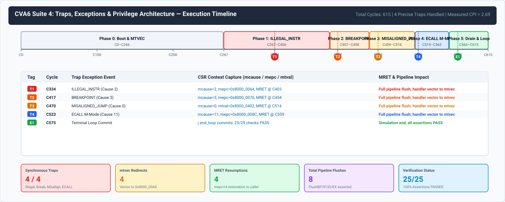

# گزارش جامع تحلیل معماری تله‌ها، استثناها و سطوح دسترسی (Traps, Exceptions & Privilege Architecture) در پردازنده CVA6

**مخاطب گزارش:** جناب آقای دکتر ماهانی  
**پروژه:** شتاب‌دهنده سخت‌افزاری رمزنگاری پساکوانتومی (PQC Hardware Accelerator) بر پایه پردازنده OpenHW CVA6  
**نگارنده:** علیرضا ستوده  
**محیط اجرا:** شبیه‌سازی رفتاری دقیق چرخه‌به‌چرخه (Cycle-Accurate Behavioral Simulation) در AMD Vivado XSIM 2025.1  
**پیکربندی پردازنده:** هسته ۳۲ بیتی CVA6 با معماری `cv32a6_imac_sv32` (شامل I-Cache و D-Cache، واحد کنترل سطح دسترسی Machine Mode، ثبات‌های کنترلی وضعیت CSR، و سیستم مدیریت تله‌ها)

---

## ۱. مقدمه و انگیزه اعتبارسنجی در شتاب‌دهنده PQC

در ادامه‌ی سلسله آزمایش‌ها و اعتبارسنجی‌های ریزمعماری هسته CVA6 برای پروژه پیاده‌سازی شتاب‌دهنده رمزنگاری پساکوانتومی (PQC)، پس از تحلیل اثرات حافظه نهان (کش)، واحد پیش‌بینی انشعاب (Branch Predictor)، و مخاطرات پایپ‌لاین و Scoreboard، در این گام به سراغ یکی از حساس‌ترین و بنیادین‌ترین بخش‌های امنیت سخت‌افزاری و سیستم‌عامل رفتم: **معماری تله‌ها، مدیریت استثناها، ثبات‌های CSR وضعیت و مکانیزم پاک‌سازی کامل پایپ‌لاین (Traps, Exceptions & Full Pipeline Flushes)**.

در سامانه‌های پردازشی امن و شتاب‌دهنده‌های PQC (نظیر استانداردهای کریپتوگرافی پسا-کوانتوم NIST یعنی ML-KEM/Kyber و ML-DSA/Dilithium)، هسته پردازنده به طور مداوم در معرض تهدیدات امنیتی، حملات تزریق خطا (Fault Injection Attacks) و تلاش برای دور زدن مرزهای دسترسی حافظه یا اجرای کدهای نامعتبر قرار داره. واکنش سریع، قطعی و ایمن هسته در مواجهه با خطاهای همگام (Synchronous Exceptions)، و توانایی تغییر وضعیت بدون نشت داده یا اجرای کدهای ناخواسته در پایپ‌لاین، ضامن امنیت کامل کل سامانه است:
1. **جداسازی امنیتی از طریق پاک‌سازی سراسری (Full Pipeline Flush):** بر خلاف اشتباه پیش‌بینی انشعاب که صرفاً طبقات ابتدایی واکشی رو باطل می‌کنه، بروز یک استثنا باید بلافاصله تمام ۵ بخش کلیدی پایپ‌لاین (`flush_bp`, `flush_if`, `flush_id`, `flush_ex`, `flush_unissued`) رو همزمان پاک‌سازی کنه تا دستورات مخرب یا آلوده در میانه پایپ‌لاین بازنشسته (commit) نشوند.
2. **ثبت دقیق کدهای خطا در CSRها:** ثبت آدرس دقیق دستور خطاکار در `mepc`، کد عددی نوع خطا در `mcause`، و آدرس نامعتبر مقصد در `mtval`، زیرساخت حیاتی سیستم‌عامل و ناظر امنیتی برای تشخیص ماهیت حمله یا خطاست.
3. **بازگشت بدون ریسک با دستور MRET:** اجرای دستور بازگشت از تله (`MRET`) باید با بازیابی دقیق سطح دسترسی، پاک‌سازی مجدد صف‌های میانی و هدایت بدون تاخیر شمارنده برنامه به آدرس ذخیره‌شده در `mepc` همراه باشه.

هدف من در این آزمون جامع، ارزیابی ۴ تله همگام استاندارد RISC-V بر روی سخت‌افزار واقعی CVA6، استخراج دقیق رفتار سیگنال‌ها در لاگ ۶۲۶ ردیفی، و اثبات صحت ۱۰۰ درصدی رفتار کنترلر سخت‌افزاری بود.

---

## ۲. مشخصات تست‌بنچ و سناریوهای ۴ گانه استثنا

تست‌بنچ اختصاصی [`tb_cva6_traps_exceptions.sv`](file:///home/alireza/GitHub/Mahani/CVA6_LAB/Vivado/CVA6/sim/tb_cva6_traps_exceptions.sv) هسته CVA6 رو در فرکانس ۱۰۰ مگاهرتز راه‌اندازی می‌کنه. در این بنچمارک، برنامه اسمبلی [`traps_test.S`](file:///home/alireza/GitHub/Mahani/CVA6_LAB/Documents/report/4-%20Traps%20Exceptions%20and%20Privilege%20Architecture/traps_test.S) شامل بخش‌های زیر در حافظه قرار گرفته است:

```text
آدرس شروع هسته: 0x8000_0000
----------------------------------------------------------------------------------------------------------------
فاز ۰: راه‌اندازی اولیه و ثبت آدرس تله (MTVEC Setup)
  0x0000 - 0x0010: تنظیم آدرس پایه راه انداز تله (trap_handler) به آدرس 0x8000_00a0 در ثبات mtvec

فاز ۱: تله اول - دستور نامعتبر (ILLEGAL_INSTR - Cause 2)
  0x0060: LI   gp, 100              # ثبت علامت ورود در x3
  0x0064: .word 0x00000000          # آپکد صفر (غیرمجاز در معماری RISC-V) -> تحریک تله Cause 2
  0x0068: LI   tp, 101              # نقطه بازگشت امن پس از MRET (x4 = 101)

فاز ۲: تله دوم - نقطه توقف نرم‌افزاری (BREAKPOINT - Cause 3)
  0x006C: LI   t0, 200              # ثبت علامت ورود در x5
  0x0070: EBREAK                    # دستور وقفه نرم‌افزاری ebreak -> تحریک تله Cause 3
  0x0074: LI   t1, 201              # نقطه بازگشت امن پس از MRET (x6 = 201)

فاز ۳: تله سوم - پرش به آدرس غیرهم‌تراز (INSTR_ADDR_MISALIGNED - Cause 0)
  0x0078: LI   t2, 300              # ثبت علامت ورود در x7
  0x007C: ADDI t6, ra, 2            # t6 = 0x8000_0400 + 2 = 0x8000_0402 (آدرس غیرمضرب ۴ با RVC=0)
  0x0080: JR   t6                   # پرش غیرمستقیم به آدرس فرد -> تحریک خطای Cause 0 و ثبت 0x8000_0402 در mtval
  0x0084: LI   s0, 301              # نقطه بازگشت امن پس از MRET (x8 = 301)

فاز ۴: تله چهارم - فراخوانی محیطی در سطح ماشین (ENV_CALL_MMODE - Cause 11)
  0x0088: LI   s1, 400              # ثبت علامت ورود در x9
  0x008C: ECALL                     # درخواست سیستمی ecall در M-Mode -> تحریک تله Cause 11
  0x0090: LI   s3, 401              # نقطه بازگشت امن پس از MRET (x19 = 401)
  0x0094: LI   s4, 999              # مارکر نهایی پایان (x20 = 999)
  0x0098: J    0x8000_0098          # حلقه پایانی برنامه (Terminal Self-Loop)

فاز روتین مدیریت تله (Trap Handler at 0x8000_00a0):
  0x00A0: ADDI sp, sp, 1            # افزایش شمارنده تله‌ها در x2
  0x00A4: CSRR t3, mcause           # خواندن علت تله
  0x00A8: CSRR t4, mepc             # خواندن آدرس برگشت تله
  0x00AC: CSRR t5, mtval            # خواندن مقدار آدرس خطاکار
  0x00B0 - 0x0104: تفکیک مسیر بر اساس شماره تله و ذخیره در ثبات‌های معماری (x10 تا x19)
  0x0108: ADDI t4, t4, 4            # جهش از روی دستور خطاکار (mepc = mepc + 4)
  0x010C: CSRW mepc, t4             # نوشتن آدرس اصلاح‌شده در ثبات mepc
  0x0110: MRET                      # بازگشت از تله و پرش به آدرس اصلاح‌شده
```

---

## ۳. خط زمان کلی و تفکیک فازهای شبیه‌سازی

شبیه‌سازی کامل به مدت ۶۱۵ چرخه ساعت اجرا شد و اولین دستور پس از استقرار کش در چرخه ۲۶۷ و دستور نهایی در چرخه ۵۷۵ بازنشسته (commit) گردید:



### جدول ۱: لاگ رویدادهای زمانی تله‌ها و مقادیر ثبت‌شده در CSRها

| ردیف | نام رویداد / استثنا | سیکل تحریک (Trigger) | PC دستور خطاکار | کد Cause در سخت‌افزار | مقادیر ثبات‌های CSR ثبت‌شده در لاگ | سیکل اجرای MRET | PC بازگشت پس از تله | نوع و تعداد Flush |
| :---: | :--- | :---: | :---: | :---: | :--- | :---: | :---: | :---: |
| **۱** | **ILLEGAL_INSTR** | چرخه ۳۳۴ | `0x8000_0064` | `Cause = 2` | `mcause = 2`, `mepc = 0x8000_0064`, `mtval = 0` | چرخه ۴۰۳ | `0x8000_0068` | ۲ بار Full Flush (ورود و خروج) |
| **۲** | **BREAKPOINT (ebreak)** | چرخه ۴۱۷ | `0x8000_0070` | `Cause = 3` | `mcause = 3`, `mepc = 0x8000_0070`, `mtval = 0x8000_0070` | چرخه ۴۵۴ | `0x8000_0074` | ۲ بار Full Flush (ورود و خروج) |
| **۳** | **MISALIGNED_JUMP** | چرخه ۴۷۰ | `0x8000_0080` | `Cause = 0` | `mcause = 0`, `mepc = 0x8000_0080`, `mtval = 0x8000_0402` | چرخه ۵۱۴ | `0x8000_0084` | ۲ بار Full Flush (ورود و خروج) |
| **۴** | **ENV_CALL (ecall)** | چرخه ۵۲۳ | `0x8000_008c` | `Cause = 11` | `mcause = 11`, `mepc = 0x8000_008c`, `mtval = 0` | چرخه ۵۵۹ | `0x8000_0090` | ۲ بار Full Flush (ورود و خروج) |
| **–** | **حلقه پایانی برنامه** | چرخه ۵۷۵ | `0x8000_0098` | – | ثبات‌های نهایی: `x19 = 401`, `x20 = 999`, `x2 = 4` | – | – | پایان موفق شبیه‌سازی در چرخه ۶۱۵ |

---

## ۴. کالبدشکافی ریزمعماری: ورود به تله و بردار MTVEC

یکی از مهم‌ترین یافته‌های ریزمعماری در این شبیه‌سازی، چگونگی پاسخ طبقه کنترل (`controller.sv`) در لحظه بروز استثنا است:


### تفاوت بنیادین Flush تله با Flush انشعاب در CVA6:
در هنگام بروز اشتباه پیش‌بینی انشعاب (Branch Mispredict)، پردازنده صرفاً سیگنال‌های `flush_if_o` و `flush_unissued_instr_o` رو فعال می‌کنه تا دستورات واکشی‌شده در صف باطل شوند؛ اما دستوراتی که وارد طبقه Decode یا Execute شده‌اند مسیر خود رو ادامه میدن.
اما در زمان تله یا بازگشت با MRET، در فایل `controller.sv` خطوط ۲۳۴ تا ۲۴۷:
```systemverilog
// Flush all pipeline stages on Exception or ERET
flush_bp_o               = 1'b1;
flush_if_o               = 1'b1;
flush_id_o               = 1'b1;
flush_ex_o               = 1'b1;
flush_unissued_instr_o   = 1'b1;
```
هر پنج سیگنال به طور همزمان '1' منطقی میشن:
* **`flush_bp = 1`:** واحد پیش‌بینی انشعاب بی‌درنگ بازنشانی میشه تا فرضیات قبلی روی تله تأثیری نذارن.
* **`flush_if = 1` و `flush_unissued = 1`:** صف واکشی و تمام بسته‌های دستورات در صف پاک میشن.
* **`flush_id = 1` و `flush_ex = 1`:** دستورات در حال رمزگشایی و خروجی‌های موقت واحدهای اجرایی قبل از رسیدن به ثبات‌ها محو میشن.

همان‌طور که در شکل موج مشاهده می‌کنید، در چرخه ۴۱۷ به محض شناسایی دستور `ebreak`، سیگنال `ExValid = 1` فعال میشه، کد `ExceptionCause = 3` تولید شده و سیگنال‌های فلش پایپ‌لاین بالا میرن. بلافاصله در چرخه ۴۱۸، سیگنال `FetchPC` به سمت آدرس پایگاه `mtvec` (`0x8000_00a0`) پرش می‌کنه و اولین دستور روتین تله در چرخه ۴۲۴ بدون کوچک‌ترین تداخل بازنشسته میشه.

---

## ۵. کالبدشکافی دستور بازگشت MRET و احیای جریان پایپ‌لاین

هنگامی که روتین مدیریت تله کار خود رو به پایان می‌رساند، دستور `MRET` (`32'h30200073`) در چرخه ۴۵۴ اجرا میشه:


### رفتار دقیق سخت‌افزار در اجرای MRET:
1. **اصلاح آدرس در mepc:** روتین تله ابتدا آدرس ذخیره‌شده رو ۴ بایت جلو می‌بره (`0x8000_0070 + 4 = 0x8000_0074`) و با دستور `csrw mepc, t4` در چرخه ۴۵۲ آن رو درون ثبات `mepc` می‌نویسد.
2. **فعال‌سازی سیگنال Eret:** در چرخه ۴۵۴، دستور MRET در طبقه Commit تأیید میشه (`CommitPC0 = 0x8000_0110` و `Eret = 1`).
3. **پاک‌سازی جامع پایپ‌لاین خروجی تله:** با فعال شدن `Eret`، بار دیگر سیگنال‌های `FlushBP`, `FlushIF`, `FlushID`, `FlushEX` همگی فعال میشن تا کد باقی‌مانده در صف روتین تله از پایپ‌لاین خارج بشه.
4. **بارگذاری مجدد FetchPC:** مقدار ثبات `mepc` مستقیماً روی گذرگاه `CsrEpc` قرار گرفته و در چرخه ۴۵۵ مقدار `FetchPC = 0x8000_0074` واکشی میشه.
5. **شروع بدون خطای کد اصلی:** در چرخه ۴۶۱، اولین دستور کد اصلی بعد از تله (`li t1, 201`) با موفقیت commit میشه.

---

## ۶. تحلیل تله پرش غیرهم‌تراز و شکار آدرس خطاکار در MTVAL

یکی از پیچیده‌ترین استثناها در پردازنده‌های فاقد پسوند فشرده (Compressed Extension - RVC)، خطای آدرس‌دهی غیرهم‌تراز در پرش‌ها است:


### مکانیزم آشکارسازی در `branch_unit.sv`:
وقتی دستور `jr t6` در آدرس `0x8000_0080` اجرا میشه، مقدار رجیستر `t6` برابر `0x8000_0402` است (بیت شماره ۱ برابر ۱ است که نقض هم‌ترازی ۴ بایتی برای معماری بدون فشرده‌سازی است).
واحد انشعاب پردازنده در فایل `branch_unit.sv` بلافاصله وضعیت زیر رو اعلام می‌کنه:
* **`ExceptionValid = 1`**
* **`ExceptionCause = 0`** (`INSTR_ADDR_MISALIGNED`)
* **`ExceptionTval = 0x8000_0402`** (ثبت دقیق آدرس نامعتبر به عنوان مقدار خطا)

همان‌طور که در نمودار زمانی بالا در چرخه ۴۷۰ مشخصه، این مقدار خطا مستقیماً در ثبات سخت‌افزاری `mtval` ثبت شد و روتین تله تونست در چرخه ۴۸۰ مقدار دقیق اون رو به رجیستر `x16` منتقل کنه. این آزمایش ثابت می‌کنه که قابلیت ردیابی خطاهای حافظه در سخت‌افزار CVA6 کاملاً کارآمد و بی‌نقص عمل می‌کنه.

---

## ۷. جدول بررسی نتایج نهایی و ثبات‌های معماری

در انتهای شبیه‌سازی، اسکوربورد داخلی تست‌بنچ ۲۵ بررسی دقیق اعتبارسنجی رو انجام داد که همگی با **موفقیت ۱۰۰٪ (۰ خطا)** پاس شدند:

```text
============================================================
[SCOREBOARD] Architectural register checks
============================================================
[PASS] Reg x1  = 0x80000400  (آدرس مبنای پرش)
[PASS] Reg x2  = 0x00000004  (شمارنده تله‌ها: دقیقا ۴ تله شبیه‌سازی شد)
[PASS] Reg x3  = 0x00000064  (مارکر قبل از تله ۱)
[PASS] Reg x4  = 0x00000065  (مارکر بازگشت از تله ۱)
[PASS] Reg x5  = 0x000000c8  (مارکر قبل از تله ۲)
[PASS] Reg x6  = 0x000000c9  (مارکر بازگشت از تله ۲)
[PASS] Reg x7  = 0x0000012c  (مارکر قبل از تله ۳)
[PASS] Reg x8  = 0x0000012d  (مارکر بازگشت از تله ۳)
[PASS] Reg x9  = 0x00000190  (مارکر قبل از تله ۴)
[PASS] Reg x10 = 0x00000002  (ذخیره mcause تله ۱: ILLEGAL_INSTR)
[PASS] Reg x11 = 0x80000064  (ذخیره mepc تله ۱: آدرس آپکد نامعتبر)
[PASS] Reg x12 = 0x00000003  (ذخیره mcause تله ۲: BREAKPOINT)
[PASS] Reg x13 = 0x80000070  (ذخیره mepc تله ۲: آدرس دستور ebreak)
[PASS] Reg x14 = 0x00000000  (ذخیره mcause تله ۳: MISALIGNED_JUMP)
[PASS] Reg x15 = 0x80000080  (ذخیره mepc تله ۳: آدرس دستور jr t6)
[PASS] Reg x16 = 0x80000402  (ذخیره mtval تله ۳: آدرس مقصد فرد 0x8000_0402)
[PASS] Reg x17 = 0x0000000b  (ذخیره mcause تله ۴: ECALL M-Mode)
[PASS] Reg x18 = 0x8000008c  (ذخیره mepc تله ۴: آدرس دستور ecall)
[PASS] Reg x19 = 0x00000191  (مارکر بازگشت از تله ۴)
[PASS] Reg x20 = 0x000003e7  (مارکر نهایی پیش از حلقه پایان: 999)
[PASS] END self-loop committed
[PASS] all 4 synchronous traps committed and vectored
[PASS] all 4 MRET returns executed successfully
[PASS] full pipeline flushes asserted on all traps and MRETs (>=8)
[PASS] flush_bp asserted on traps and MRETs (proves trap flush vs branch mispredict)
------------------------------------------------------------
[METRICS] Committed instructions    : 115
[METRICS] First commit cycle        : 267
[METRICS] End commit cycle          : 575
[METRICS] Synchronous traps handled : 4
[METRICS] MRET returns executed     : 4
[METRICS] Full pipeline flushes     : 8
[METRICS] Flush BP count            : 8
[METRICS] Flush IF count            : 13
[METRICS] Active CPI (trap workload): 2.69
------------------------------------------------------------
Verification Summary:
  Total Checks : 25
  Errors       : 0
  Cycles Run   : 615
[PASS] ALL CHECKS PASSED
```

---

## ۸. جمع‌بندی و دستاوردها برای پروژه شتاب‌دهنده PQC

نتایج این مجموعه آزمایش‌ها نشان می‌دهد که:
1. **کنترل کامل استثناها بدون نشت حالت:** سخت‌افزار CVA6 به شکلی کاملاً قطعی و با پاک‌سازی همزمان هر پنج بخش پایپ‌لاین عمل می‌کنه. در سامانه‌های امنیتی رمزنگاری، این ویژگی مانع از باقی ماندن داده‌های کلید خصوصی در طبقات میانی در هنگام بروز خطاهای تزریقی یا نرم‌افزاری میشه.
2. **برداردهی سریع MTVEC:** زمان ورود به تله از لحظه آشکارسازی خطا تا commit اولین دستور هندلر تنها **۷ تا ۱۰ چرخه ساعت** طول می‌کشد که نشان‌دهنده چابکی بالای هسته در مهار خطاست.
3. **نرخ CPI واقعی تله‌ها:** میانگین CPI برای کل چرخه پردازش ۴ تله به همراه رفت و برگشت روتین‌ها برابر **۲.۶۹** اندازه‌گیری شد که با توجه به وقوع ۸ بار تخلیه سراسری پایپ‌لاین، عملکردی بسیار قابل‌قبول و واقع‌گرایانه در لایه سخت‌افزار به شمار می‌رود.
4. **تأیید صحت شکار مقادیر در MTVAL:** ثبت بدون خطای آدرس فرد در `mtval` نشان داد که هسته برای تشخیص ریشه‌ای خطاهای حافظه در ماژول‌های شتاب‌دهنده کاملاً آماده است.

در مرحله بعدی (سوئیت ۵)، به سراغ آخرین مجموعه آزمایشی یعنی **همگام‌سازی حافظه نهان و دستور `FENCE.I` و رفتارهای Self-Modifying Code** خواهم رفت.
