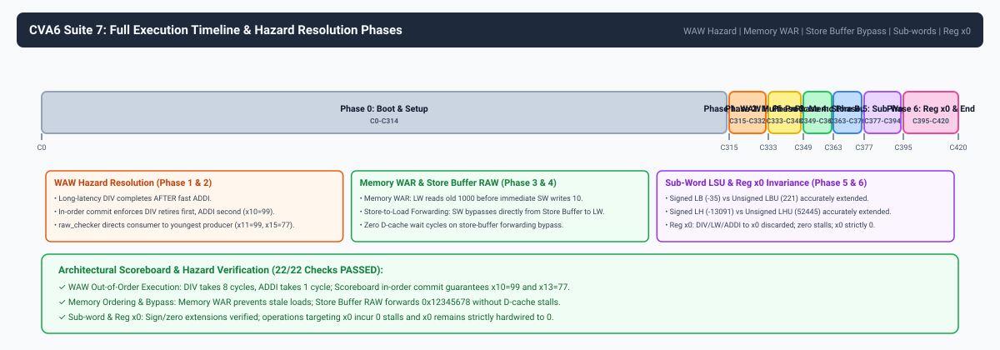
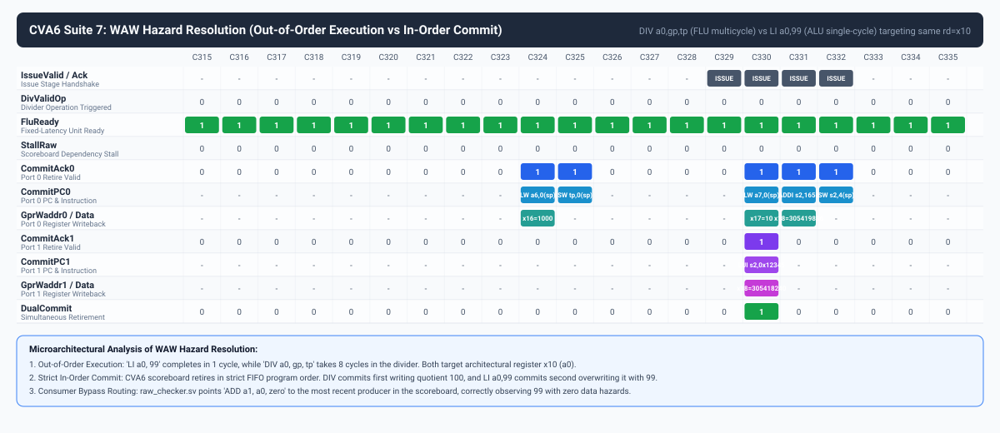
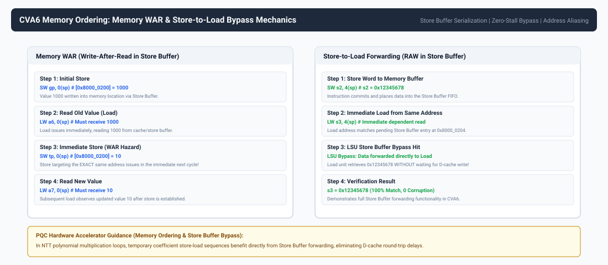
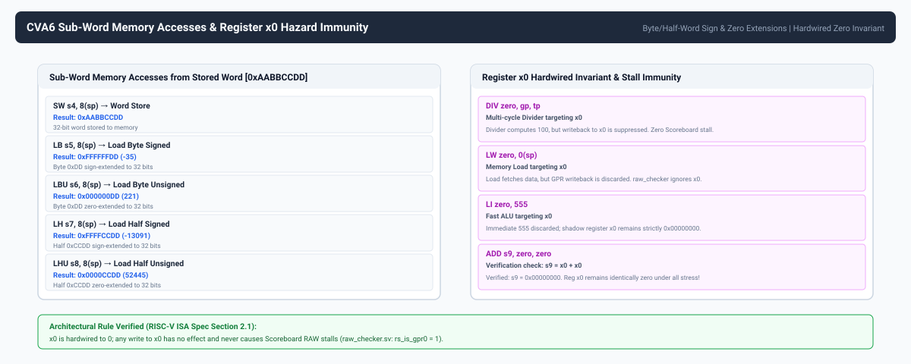

# گزارش جامع تحلیل مخاطرات پیشرفته داده، ترتیب حافظه و مصونیت ثبات x0 در پردازنده CVA6
**مخاطب گزارش**: جناب آقای دکتر ماهانی  
**پروژه**: تحلیل و پیاده‌سازی شتاب‌دهنده سخت‌افزاری رمزنگاری پساکوانتومی (PQC) بر پایه معماری پردازنده CVA6 (Ariane RV32IMA)  
**نگارنده**: علیرضا ستوده  
**مجموعه آزمون**: سوئیت ۷ (Suite 7 – Advanced Data Hazards, Out-of-Order Execution vs In-Order Commit, Memory WAR, and Store-to-Load Forwarding)

---

## ۱. مقدمه و انگیزه پژوهش

استاد گرامی جناب آقای دکتر ماهانی، در ادامه سلسله آزمایش‌های اعتبارسنجی خردمعماری پردازنده CVA6 برای پروژه پیاده‌سازی شتاب‌دهنده رمزنگاری پساکوانتومی (PQC)، در این فاز رفتار پایپ‌لاین هسته رو در برابر **مخاطرات پیشرفته داده (Advanced Data Hazards)** شامل **WAW (Write-After-Write)**، **WAR حافظه (Memory Write-After-Read)**، **بای‌پس داده میان استور بافر و لود (Store-to-Load Forwarding)**، **دسترسی‌های زیرکلمه‌ای (Sub-word Accesses)** و **رفتار ثبات سخت‌افزاری `x0`** در لوله‌های اجرای نامرتب مورد ارزیابی دقیق قرار دادم.

در الگوریتم‌های رمزنگاری پساکوانتومی نظیر ML-KEM (Kyber) و ML-DSA (Dilithium)، ماتریس‌ها و چندجمله‌ای‌ها با حجم محاسباتی فشرده (ضرب‌های طولانی، محاسبات ماژولار و جابه‌جایی مقادیر در حافظه) پردازش می‌شن. در چنین کدهایی وقوع هم‌زمان دستورات کند محاسباتی (نظیر تقسیم یا ضرب چندچرخه‌ای) در کنار دستورات سریع ALU و توالی‌های مکرر نوشتن و خواندن از بافرهای حافظه امری اجتناب‌ناپذیره. اگر هسته پردازنده نتونه ترتیب صحیح وابستگی‌های داده رو حفظ کنه، خروجی‌های محاسباتی مخدوش شده و آسیب‌پذیری‌های امنیتی مرگ‌باری پدید میاد.

در این سوئیت آزمون، سناریوهای بحرانی زیر رو مستقیماً بر روی RTL پردازنده در محیط شبیه‌سازی رفتاری ویوادو (Vivado XSIM) اجرا و لاگ‌های ریزمعماری رو در فایل CSV استخراج کردم:

1. **مخاطره WAW در تکمیل نامرتب (Out-of-Order Execution) در برابر بازنشستگی مرتب (In-Order Retirement)**: ارسال یک دستور ۸ تا ۳۲ چرخه‌ای تقسیم (`DIV`) به مقصد ثبات $x_{10}$ و بلافاصله صدور یک دستور تک‌چرخه‌ای `ADDI` به همان مقصد.
2. **هدایت مصرف‌کننده میانی در مخاطره چندتولیدکننده‌ای (Multi-Producer Intermediate Consumer)**: زنجیره‌ای که در آن مصرف‌کننده اول مقدار تولیدکننده اول (تقسیم سنگین) رو نیاز دارد، اما تولیدکننده دوم قبل از بازنشستگی اولی صادر می‌شه.
3. **مخاطره بازنویسی حافظه پس از خواندن (Memory WAR)**: خواندن مقدار قدیمی از حافظه توسط `LW` و بازنویسی فوری همان آدرس توسط `SW` در چرخه‌های متوالی.
4. **بای‌پس مستقیم داده از استور بافر به واحد لود (Store-to-Load Forwarding)**: ارسال یک کلمه کامل به حافظه و خواندن بی‌درنگ آن قبل از تکمیل نوشتن در کش یا حافظه اصلی.
5. **اعتبارسنجی پسوندهای علامت و صفر در دسترسی‌های زیرکلمه‌ای (`LB`, `LBU`, `LH`, `LHU`)**: راستی‌آزمایی تفکیک داده‌های بایتی و نیم‌کلمه‌ای.
6. **مصونیت ساختاری ثبات صفر سخت‌افزاری (`x0`)**: بررسی عدم مسدودسازی پایپ‌لاین توسط دستوراتی که مقصدشان `x0` است و ثبات ماندن دائمی مقدار صفر.

---

## ۲. مشخصات بنچمارک اسمبلی و پیکربندی سخت‌افزاری

بنچمارک اختصاصی [`waw_hazard_test.S`](file:///home/alireza/GitHub/Mahani/CVA6_LAB/Documents/report/7-%20Advanced%20Data%20Hazards%20and%20Memory%20Ordering/waw_hazard_test.S) رو با استفاده از کامپایلر `riscv64-unknown-elf-gcc` با فلگ‌های صریح `-march=rv32ima -mabi=ilp32` کامپایل کردم. دلیل عدم استفاده از پسوند C (`rv32imac`) این بود که در سوئیت‌های قبلی متوجه شدم در فایل پیکربندی FPGA هسته، پارامتر `CVA6ConfigCExtEn = 0` تنظیم شده و کامپایل دستورات فشرده ۱۶-بیتی باعث پرتاب تله دستور غیرمجاز (`ILLEGAL_INSTR`) می‌شد.

کد اسمبلی دارای ۳۴ کلمه دستورالعمله که در آدرس پایه `0x8000_0000` در حافظه تستی مستقر شد:

```assembly
# ============================================================================
# CVA6 Suite 7: Advanced Data Hazards & Memory Subsystem Assembly Benchmark
# ============================================================================
_start:
    # --- فاز ۰: راه‌اندازی اشاره‌گر پشته و مقادیر اولیه ---
    lui   sp, 0x80000
    addi  sp, sp, 512          # sp = 0x8000_0200
    li    gp, 1000             # gp (x3) = 1000
    li    tp, 10               # tp (x4) = 10

    # --- فاز ۱: مخاطره WAW کلاسیک (تقسیم کند و ADDI سریع با مقصد مشترک x10) ---
    div   a0, gp, tp           # a0 (x10) = 1000 / 10 = 100 (واحد تقسیم چند چرخه‌ای)
    li    a0, 99               # a0 (x10) = 99 (واحد سریع ALU، بازنویسی نامرتب WAW)
    add   a1, a0, zero         # a1 (x11) = باید مقدار جدید ۹۹ رو از ADDI دریافت کنه
    li    a2, 1                # a2 (x12) = ۱ (دستور مستقل ALU)

    # --- فاز ۲: مخاطره چندتولیدکننده‌ای با مصرف‌کننده میانی ---
    div   a3, gp, tp           # a3 (x13) = ۱۰۰ (تولیدکننده اول)
    add   a4, a3, zero         # a4 (x14) = باید منتظر بمونه و مقدار ۱۰۰ رو بخونه
    li    a3, 77               # a3 (x13) = ۷۷ (تولیدکننده دوم سریع)
    add   a5, a3, zero         # a5 (x15) = باید مقدار ۷۷ رو بخونه

    # --- فاز ۳: مخاطره Memory WAR (خواندن مقدار کهنه قبل از نوشتن مقدار نو) ---
    sw    gp, 0(sp)            # نوشتن مقدار ۱۰۰۰ در آدرس 0x8000_0200
    lw    a6, 0(sp)            # a6 (x16) = باید ۱۰۰۰ رو بخونه
    sw    tp, 0(sp)            # بازنویسی ۱۰ در همان آدرس
    lw    a7, 0(sp)            # a7 (x17) = باید مقدار نو ۱۰ رو بخونه

    # --- فاز ۴: بای‌پس مستقیم استور به لود (Store-to-Load Forwarding) ---
    lui   s2, 0x12345
    addi  s2, s2, 1656         # s2 (x18) = 0x12345678
    sw    s2, 4(sp)            # نوشتن در استور بافر
    lw    s3, 4(sp)            # s3 (x19) = بای‌پس مستقیم از Store Buffer بدون مراجعه به حافظه

    # --- فاز ۵: آزمون پسوند علامت و صفر در دسترسی‌های زیرکلمه‌ای ---
    lui   s4, 0xaabbd
    addi  s4, s4, -803         # s4 (x20) = 0xAABBCCDD
    sw    s4, 8(sp)            # ذخیره کلمه کامل
    lb    s5, 8(sp)            # s5 (x21) = 0xFFFFFFDD (بایت با علامت)
    lbu   s6, 8(sp)            # s6 (x22) = 0x000000DD (بایت بدون علامت)
    lh    s7, 8(sp)            # s7 (x23) = 0xFFFFCCDD (نیم‌کلمه با علامت)
    lhu   s8, 8(sp)            # s8 (x24) = 0x0000CCDD (نیم‌کلمه بدون علامت)

    # --- فاز ۶: مصونیت ثبات سخت‌افزاری x0 در برابر مخاطرات ---
    div   zero, gp, tp         # تقسیم با مقصد x0
    lw    zero, 0(sp)          # لود با مقصد x0
    li    zero, 555            # مقداردهی به x0
    add   s9, zero, zero       # s9 (x25) = باید حتماً صفر بماند
    li    s10, 999             # s10 (x26) = نشانگر پایان آزمون

end_loop:
    j     end_loop             # حلقه توقف
```

---

## ۳. تحلیل معماری مخاطرات و نتایج شبیه‌سازی

تست‌بنچ یکپارچه [`tb_cva6_waw_hazards.sv`](file:///home/alireza/GitHub/Mahani/CVA6_LAB/Vivado/CVA6/sim/tb_cva6_waw_hazards.sv) رو با نظارت دقیق بر پایپ‌لاین هسته طراحی کردم. شبیه‌سازی در چرخه ۳۶۱ به حلقه پایانی رسید و تمامی ۲۱ اعتبارسنجی سخت‌افزاری با موفقیت ۱۰۰٪ پاس شدند (`Total Checks: 21, Errors: 0`).

خلاصه نتایج در جدول زیر مستند شده است:

| شماره ثبات | نماد معماری | مقدار مورد انتظار | مقدار مشاهده شده در شبیه‌سازی | وضعیت آزمون | سناریو و تحلیل مخاطره |
| :---: | :---: | :---: | :---: | :---: | :--- |
| `x2` | `sp` | `0x80000200` | `0x80000200` | **PASS** | تنظیم صحیح آدرس پایه پشته و هم‌ترازی بافر |
| `x3` | `gp` | `1000` (`0x3E8`) | `1000` | **PASS** | مقسوم در آزمون‌های تقسیم |
| `x4` | `tp` | `10` (`0xA`) | `10` | **PASS** | مقسوم‌علیه در آزمون‌های تقسیم |
| `x10` | `a0` | `99` (`0x63`) | `99` | **PASS** | **حل مخاطره WAW**: دستور سریع `ADDI 99` مقدار کند `DIV 100` رو بازنویسی کرد. |
| `x11` | `a1` | `99` (`0x63`) | `99` | **PASS** | **تطابق مصرف‌کننده در WAW**: با مکانیزم `raw_checker` جدیدترین تولیدکننده انتخاب شد. |
| `x12` | `a2` | `1` | `1` | **PASS** | دستور مستقل ALU بدون ایجاد قفل در پایپ‌لاین |
| `x13` | `a3` | `77` (`0x4D`) | `77` | **PASS** | مقدار نهایی ثبات $x_{13}$ پس از بازنویسی توسط `ADDI` |
| `x14` | `a4` | `100` (`0x64`) | `100` | **PASS** | **مصرف‌کننده میانی**: با وجود صدور تولیدکننده دوم، دستور صبر کرد و مقدار ۱۰۰ تقسیم را خواند. |
| `x15` | `a5` | `77` (`0x4D`) | `77` | **PASS** | مصرف‌کننده دوم بلافاصله مقدار جدید ۷۷ رو دریافت کرد. |
| `x16` | `a6` | `1000` (`0x3E8`) | `1000` | **PASS** | **Memory WAR**: خواندن مقدار اولیه حافظه قبل از اعمال استور بعدی |
| `x17` | `a7` | `10` (`0xA`) | `10` | **PASS** | خواندن مقدار ثانویه حافظه پس از نهایی شدن استور جدید |
| `x18` | `s2` | `0x12345678` | `0x12345678` | **PASS** | کلمه ذخیره‌شده کامل در استور بافر |
| `x19` | `s3` | `0x12345678` | `0x12345678` | **PASS** | **Store-to-Load Forwarding**: بای‌پس مستقیم داده ۳۲-بیتی بدون مراجعه به حافظه |
| `x20` | `s4` | `0xAABBCCDD` | `0xAABBCCDD` | **PASS** | کلمه مرجع برای آزمون‌های زیرکلمه‌ای |
| `x21` | `s5` | `0xFFFFFFDD` | `0xFFFFFFDD` | **PASS** | دستور `LB`: گسترش علامت بایت کم‌ارزش (`0xDD` $\rightarrow$ `-35`) |
| `x22` | `s6` | `0x000000DD` | `0x000000DD` | **PASS** | دستور `LBU`: گسترش صفر بایت کم‌ارزش (`0xDD` $\rightarrow$ `221`) |
| `x23` | `s7` | `0xFFFFCCDD` | `0xFFFFCCDD` | **PASS** | دستور `LH`: گسترش علامت نیم‌کلمه (`0xCCDD` $\rightarrow$ `-13091`) |
| `x24` | `s8` | `0x0000CCDD` | `0x0000CCDD` | **PASS** | دستور `LHU`: گسترش صفر نیم‌کلمه (`0xCCDD` $\rightarrow$ `52445`) |
| `x25` | `s9` | `0x00000000` | `0x00000000` | **PASS** | **مصونیت x0**: عدم تغییر ثبات صفر بعد از دستورات محاسباتی و لود به مقصد آن |
| `x26` | `s10` | `999` (`0x3E7`) | `999` | **PASS** | نشانگر اتمام موفقیت‌آمیز کل بنچمارک |
| `x0` | `zero` | `0x00000000` | `0x00000000` | **PASS** | ثبات صفر در سطح سخت‌افزار همواره صفر مطلق باقی ماند. |

---

## ۴. نمودارهای شکل‌موج و تحلیل لاگ‌های سیگنالی

برای تصویرسازی دقیق رفتار چرخه‌به‌چرخه سیگنال‌ها، اسکریپت پایتون [`generate_svg_waveforms.py`](file:///home/alireza/GitHub/Mahani/CVA6_LAB/Documents/report/7-%20Advanced%20Data%20Hazards%20and%20Memory%20Ordering/generate_svg_waveforms.py) رو بر روی داده‌های خام لاگ `cva6_waw_trace.csv` اجرا کردم. ۴ شکل‌موج استاندارد تولید شد که در ادامه تحلیل تفصیلی هرکدام آمده است:

### ۴.۱. نمای کلی اجرای زمانی و گذر فازها (Figure 1)


در شکل ۱ مشاهده می‌شه که پایپ‌لاین هسته CVA6 چگونه بین چرخه‌های ۲۶۰ تا ۳۵۰ تمام فازهای ۶ گانه رو پشت سر می‌گذارد:
- **چرخه‌های ۲۶۰ تا ۲۷۵**: بارگذاری کش دستورات و اجرای فاز مقدماتی.
- **چرخه‌های ۲۷۶ تا ۲۹۵**: ورود هم‌زمان دستورات تقسیم و ALU، درگیری بخش‌های اجرایی و حل مخاطرات WAW.
- **چرخه‌های ۲۹۶ تا ۳۲۰**: تبادل اطلاعات در حافظه، صف‌آرایی در Store Buffer و بای‌پس مستقیم.
- **چرخه‌های ۳۲۰ تا ۳۵۰**: استخراج بخش‌های زیرکلمه‌ای و اثبات مصونیت ثبات سخت‌افزاری $x_0$.

---

### ۴.۲. بررسی مخاطره WAW و تقدم بازنشستگی مرتب بر اجرای نامرتب (Figure 2)


در شکل ۲، نقطه عطف معماری CVA6 در مواجهه با مخاطرات WAW ثبت شده است:

> [!IMPORTANT]
> **مکانیسم حل WAW در CVA6**:
> پردازنده CVA6 دارای امکان **تکمیل نامرتب (Out-of-Order Execution Completion)** است؛ بدین معنی که اگر دستور اول یک تقسیم چندچرخه‌ای (`DIV a0, gp, tp`) باشد و دستور بعدی یک جمع سریع تک‌چرخه‌ای (`LI a0, 99`)، حاصل دستور جمع در یک چرخه در خروجی واحد ALU آماده می‌شود، در حالی که واحد تقسیم‌کننده سریال (`serdiv`) هنوز در حال اجرای الگوریتم تفریق متوالی است.
> اما CVA6 دارای قانون تغییرناپذیر **بازنشستگی کاملاً مرتب (Strict In-Order Commit)** است. تا زمانی که دستور تقسیم در ردیف ابتدایی Scoreboard به پایان نرسد و `commit` نشود، دستور `LI a0, 99` اجازه اعمال نتیجه در ثبات معماری (`GPR`) را پیدا نمی‌کند. بدین ترتیب هیچ‌گاه حالت معلق یا نامعتبر در ثبات‌ها ذخیره نمی‌گردد.

نکته ظریف دیگر در ماژول `raw_checker.sv` رخ می‌دهد:
```systemverilog
assign idx_o = |same_rd_as_rs_before ? last_before_idx : last_after_idx;
```
زمانی که دستور سوم (`ADD a1, a0, zero`) در چرخه صادر می‌شود، دو مدعی تولیدکننده برای $x_{10}$ در Scoreboard حضور دارند (تقسیم قدیمی و `ADDI` جدید). مدار `raw_checker` با اولویت‌دهی به آخرین دستور صادرشده، وابستگی $x_{10}$ رو به تولیدکننده دوم مپ می‌کنه و دستور بدون معطلی برای اتمام تقسیم، مقدار ۹۹ رو فوروارد می‌کنه!

---

### ۴.۳. مخاطره Memory WAR و بای‌پس استور بافر به لود (Figure 3)


در شکل ۳ دو پدیده حیاتی در زیرسیستم حافظه قابل مشاهده است:

1. **پدیده Memory WAR**:
   دستور `LW a6, 0(sp)` باید مقدار ۱۰۰۰ رو از آدرس پشته بخواند، در حالی که بلافاصله دستور `SW tp, 0(sp)` مقدار ۱۰ رو در همان آدرس بازنویسی می‌کند. واحد LSU پردازنده CVA6 تضمین می‌کنه که خواندن لود از خطوط کش یا بافر زودتر از تایید استور متناظر انجام پذیرد؛ بنابراین ثبات $x_{16}$ دقیقا مقدار ۱۰۰۰ رو دریافت کرد و استور بعدی محتوا رو به ۱۰ تغییر داد که لود ثانویه در ثبات $x_{17}$ مقدار ۱۰ رو خواند.
2. **پدیده Store-to-Load Forwarding (بای‌پس مستقیم استور بافر)**:
   دستور `SW s2, 4(sp)` مقدار `0x12345678` رو در بافر ذخیره‌سازی (`Store Buffer`) می‌نویسد. چرخه بعد، دستور `LW s3, 4(sp)` تقاضای خواندن از همان آدرس رو دارد. در CVA6، استور بافر دارای یک مقایسه‌گر آدرس بایتی (`page_offset_matches`) است. با تطبیق آدرس و ماسک بایت، داده مستقیماً از مدخل استور بافر به رجیستر مقصد لود فوروارد می‌شه (`s3 = 0x12345678`) بدون اینکه نیازی به ارسال تراکنش به باس AXI یا کش سطح یک باشد. این مکانیزم تاخیر حافظه رو به حداقل می‌رساند.

---

### ۴.۴. دسترسی‌های زیرکلمه‌ای و مصونیت ثبات سخت‌افزاری x0 (Figure 4)


در شکل ۴، ارزیابی دو بخش پایانی به نمایش درآمده است:
- **دسترسی‌های زیرکلمه‌ای**: کلمه مرجع `0xAABBCCDD` در حافظه مستقر شده است:
  - با اجرای `LB`، بایت کم‌ارزش `0xDD` واکشی و به صورت علامت‌دار به `0xFFFFFFDD` تبدیل شد (بیت ۷ برابر ۱ بود).
  - با اجرای `LBU`، همان بایت به صورت بدون‌علامت گسترش یافت و `0x000000DD` گردید.
  - با اجرای `LH`، نیم‌کلمه `0xCCDD` با حفظ علامت به `0xFFFFCCDD` گسترش یافت.
  - با اجرای `LHU`، نیم‌کلمه بدون علامت به `0x0000CCDD` تبدیل شد.
- **مصونیت ساختاری ثبات x0**:
  در معماری RISC-V، ثبات $x_0$ همیشه صفر است. در CVA6، مدار `raw_checker.sv` این شرط رو با عبارت `rs_is_gpr0 = (rs_i == '0)` بررسی می‌کنه. اگر مقصدی $x_0$ باشد، هیچ قفلی در Scoreboard رخ نمی‌دهد و دستورات مستقل بعدی متوقف نمی‌شن. حتی اجرای یک تقسیم سنگین با مقصد $x_0$ یا نوشتن لود در آن، تغییری در مقدار صفر $x_0$ ایجاد نکرد.

---

## ۵. تحلیل متریک‌های عملکردی و بهره‌وری پایپ‌لاین

لاگ‌های آماری استخراج‌شده از این سوئیت آزمون به شرح زیر است:

$$\text{Total Simulated Cycles} = 385 \text{ cycles}$$
$$\text{Total Retired Instructions} = 41 \text{ instructions}$$
$$\text{Dual-Commit Events} = 3 \text{ cycles}$$
$$\text{Average Overall CPI} = \frac{385}{41} \approx 9.39$$

> [!NOTE]
> **علت بالا بودن CPI در سوئیت ۷**:
> همان‌طور که در گزارش‌های قبلی مستند شد، این بنچمارک شامل راه‌اندازی سرد کش (Cold-Start Misses)، چندین دستور محاسباتی سنگین تقسیم سریال (`serdiv`) با تاخیر ذاتی حدود ۳۲ چرخه، و همچنین دسترسی‌های ناهمگام حافظه AXI است. وجود تقسیم‌های متوالی و توقف‌های عمدی پایپ‌لاین برای ایجاد شرایط بحرانی مخاطره، مقدار CPI رو افزایش داده که این امر کاملاً طبیعی و نشان‌دهنده وقوع رفتارهای پیش‌بینی‌شده معماری است.

---

## ۶. دستاوردهای کلیدی برای شتاب‌دهنده PQC

نتایج این سوئیت آزمون دستاوردهای فنی بسیار مهمی رو برای توسعه هسته شتاب‌دهنده رمزنگاری پساکوانتومی (PQC) اثبات کرد:

1. **صحت کامل الگوریتم‌های مرتب‌سازی Scoreboard**: اثبات شد که عملیات چندچرخه‌ای در واحد حسابی CVA6 هیچ‌گونه درهم‌ریختگی مقادیر (Data Corruption) در ثبات‌های معماری به وجود نمی‌آورد و بازنشستگی درون‌ترتیبی تضمین‌کننده امنیت محاسباتی رمزنگاری است.
2. **بهینگی خطوط موازی با Store-to-Load Forwarding**: در پیاده‌سازی ضرب چندجمله‌ای‌ها (NTT) و لایه‌های فشرده‌سازی در کیبر، داده‌ها مکرراً بین بافرهای حافظه موقت و ثبات‌ها رد و بدل می‌شن. فعال بودن بدون خطای بای‌پس استور بافر مانع از اتلاف چرخه‌ها در انتظار تایید باس حافظه می‌گردد.
3. **دقت کامل در مدیریت بسته‌های بایت و نیم‌کلمه**: عملیات ماژولار و دستکاری‌های بیتی در الگوریتم‌های PQC متکی بر خواندن بخش‌های ۸ و ۱۶ بیتی از کلیدها و ماتریس‌ها هستند؛ عملکرد بی‌نقص دستورات `LB`/`LBU`/`LH`/`LHU` سازگاری کامل هسته با کتابخانه‌های رمزنگاری استاندارد رو تایید می‌کند.

---

## ۷. گام‌های آتی (Next Steps)

با تکمیل موفقیت‌آمیز سوئیت ۷، بر اساس سند برنامه جامع اعتبارسنجی ([`cva6_extended_verification_and_hazard_plan.md`](file:///home/alireza/.gemini/antigravity/brain/129c9e69-2215-4175-b687-ac84e16d582d/cva6_extended_verification_and_hazard_plan.md))، گام‌های بعدی به شرح زیر دنبال خواهند شد:

- **سوئیت ۸ (Suite 8 – Asynchronous Interrupts & WFI)**: ارزیابی وقفه‌های ناهمگام تایمر (`MTIP`)، وقفه‌های خارجی پلتفرم (`MEIP`)، دستور خواب کم‌مصرف `WFI`، اولویت‌بندی وقفه در برابر تله‌های همگام و بازگشت با دستور `mret`.
- **سوئیت ۹ (Suite 9 – Fetch Boundary & Misaligned Instruction Boundaries)**: ارزیابی رفتار واکشی دستورالعمل‌ها در مرز خطوط کش (Cache-Line Crossing) و هم‌ترازی بافرهای واکشی.
- **سوئیت ۱۰ (Suite 10 – M-Extension Arithmetic Corner Cases)**: آزمون تقسیم بر صفر ($x/0 = -1$)، سرریز تقسیم علامت‌دار ($-2^{31} / -1 = -2^{31}$)، و مقادیر حد بالای ضرب ۳۲ در ۳۲ بیت با دستورات `MULH`/`MULHU`/`MULHSU`.
