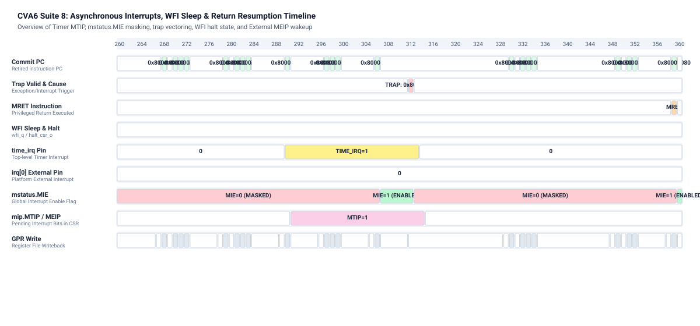
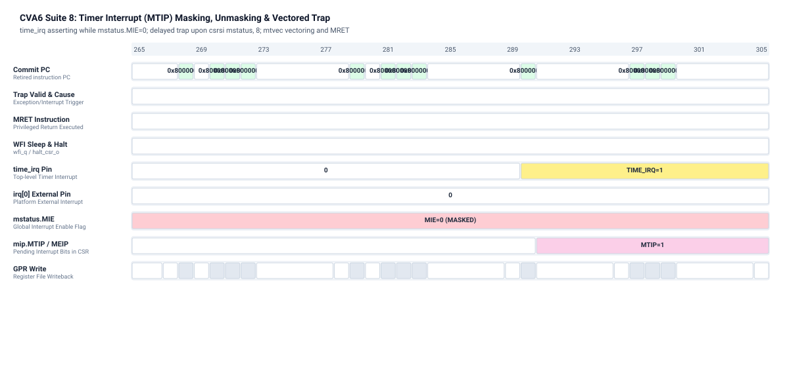
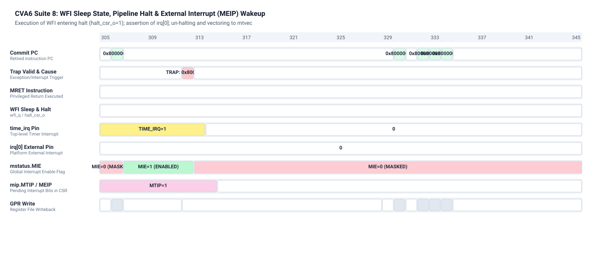
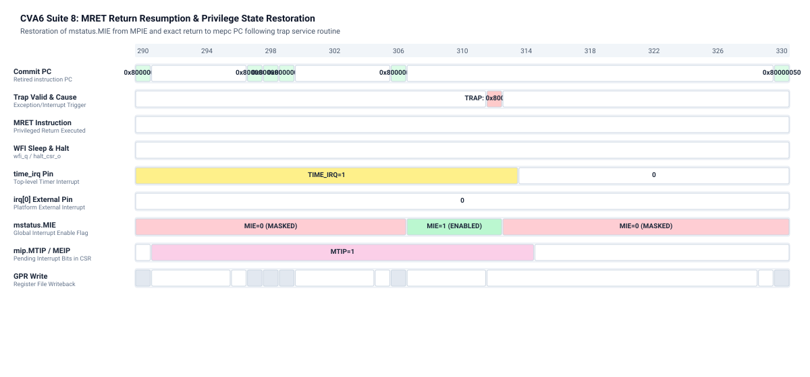

# گزارش جامع تحلیل وقفه‌های ناهمگام، مکانیزم ماسک‌گذاری، حالت خواب WFI و بازگشت با MRET در پردازنده CVA6
**مخاطب گزارش**: جناب آقای دکتر ماهانی  
**پروژه**: تحلیل و پیاده‌سازی شتاب‌دهنده سخت‌افزاری رمزنگاری پساکوانتومی (PQC) بر پایه معماری پردازنده CVA6 (Ariane RV32IMA)  
**نگارنده**: علیرضا ستوده  
**مجموعه آزمون**: سوئیت ۸ (Suite 8 – Asynchronous Interrupts, Timer MTIP, External MEIP, mstatus.MIE Masking, Low-Power WFI Sleep/Wakeup, and MRET Return Resumption)

---

## ۱. مقدمه و انگیزه پژوهش

استاد گرامی جناب آقای دکتر ماهانی، در ادامه سلسله آزمایش‌های تحلیل خردمعماری پردازنده CVA6 برای پروژه شتاب‌دهنده رمزنگاری پساکوانتومی (PQC)، در این فاز رفتار هسته رو در برابر **رویدادهای ناهمگام بلادرنگ (Asynchronous Real-Time Events)** شامل **وقفه تایمر سیستم (`MTIP`)**، **وقفه خارجی شتاب‌دهنده (`MEIP`)**، **مکانیزم ماسک‌گذاری اولویت‌دار در ثبات وضعیت (`mstatus.MIE`)**، **حالت خواب کم‌مصرف لوله با دستور `WFI` (Wait For Interrupt)** و **بازیابی حالت پایپ‌لاین با دستور `MRET`** در محیط شبیه‌سازی رفتاری ویوادو (Vivado XSIM) با دقت چرخه مورد ارزیابی قرار دادم.

در سامانه‌های پردازشی امنیتی و شتاب‌دهنده‌های رمزنگاری پساکوانتومی (مانند ماژول‌های سخت‌افزاری شتاب‌دهنده Kyber یا Dilithium):
1. **همگام‌سازی ناهمگام ماژول شتاب‌دهنده و هسته**: هنگامی که موتور سخت‌افزاری NTT (تبدیل تئوری اعداد) یا شتاب‌دهنده Keccak کار ضرب چندجمله‌ای‌ها یا هشینگ رو به پایان می‌رساند، یک سیگنال وقفه خارجی (`irq_i[0]` یا `MEIP`) به هسته صادر می‌کند تا CPU رو از اتمام پردازش مطلع سازد.
2. **مدیریت توان مصرفی با WFI**: هسته مرکزی نباید در زمان اجرای محاسبات سنگین شتاب‌دهنده با حلقه‌های بیهوده (Busy-Waiting Polling) توان هدر دهد؛ بلکه باید با اجرای دستور `WFI` به حالت تعلیق رفته و با کمترین تاخیر با وقفه سخت‌افزاری بیدار شود.
3. **حفظ حالت امنیتی و پایداری ثبات‌ها**: وقوع یک وقفه در میانه یک توالی حساس نباید باعث نشت داده، درهم‌ریختگی ثبات‌ها یا پرش به آدرس نامعتبر گردد.

در این سوئیت آزمون، کلیه سناریوهای فوق رو در سطح RTL پیاده‌سازی و رفتار هسته رو اعتبارسنجی کردم.

---

## ۲. مشخصات بنچمارک اسمبلی و توالی محرک‌های ناهمگام

بنچمارک اسمبلی [`interrupts_wfi_test.S`](file:///home/alireza/GitHub/Mahani/CVA6_LAB/Documents/report/8-%20Asynchronous%20Interrupts%20and%20WFI/interrupts_wfi_test.S) با معماری ۳۲ بیتی `-march=rv32ima_zicsr -mabi=ilp32` کامپایل شد. این بنچمارک شامل بخش‌های زیر است:

```assembly
# ============================================================================
# CVA6 Suite 8: Asynchronous Interrupts, WFI and Privilege Resumption
# ============================================================================
_start:
    # --- فاز ۰: راه‌اندازی بردار وقفه (mtvec) و ثبات‌های فعال‌ساز ---
    lui   sp, 0x80000
    addi  sp, sp, 512          # sp = 0x8000_0200
    la    t0, isr_trap_handler
    csrw  mtvec, t0            # mtvec = آدرس روتین وقفه (0x8000_0050)
    li    t0, 0x880            # فعال‌سازی وقفه تایمر (MTIE: 0x80) و خارجی (MEIE: 0x800)
    csrw  mie, t0
    csrci mstatus, 8           # غیرفعال کردن وقفه سراسری (MIE = 0: ماسک شده)

    # --- فاز ۱: آزمون ماسک‌گذاری (فعال شدن وقفه حین MIE = 0) ---
    # تست‌بنچ سیگنال time_irq = 1 را اعمال می‌کند؛ وقفه نباید فعال شود!
    li    a0, 17               # a0 (x10) = 17 (0x11: نشانه اجرای بدون مانع حین ماسک)
    li    ra, 1
    addi  ra, ra, 1            # ra (x1) = 2

    # --- فاز ۲: رفع ماسک (MIE = 1) و پرتاب وقفه تایمر ---
    csrsi mstatus, 8           # MIE = 1 -> بلافاصله وقفه فعال و هسته به mtvec پرش می‌کند!
    li    a2, 34               # a2 (x12) = 34 (0x22: نشانه بازگشت موفق از ISR تایمر با MRET)

    # --- فاز ۳: حالت خواب کم‌مصرف WFI و بیدارباش با وقفه خارجی ---
    li    a3, 51               # a3 (x13) = 51 (0x33: نشانه قبل از خواب)
    wfi                        # توقف کامل لوله‌ها و خواب هسته تا رسیدن وقفه خارجی
    li    a5, 68               # a5 (x15) = 68 (0x44: نشانه بیداری و بازگشت از ISR با MRET)
    li    s10, 999             # s10 (x26) = 999 (نشانگر اتمام موفقیت‌آمیز)

end_loop:
    j     end_loop

# --- روتین مدیریت وقفه (ISR) ---
.align 4
isr_trap_handler:
    csrr  t1, mcause           # خواندن علت وقفه
    li    t2, 0x80000007       # کد وقفه تایمر ماشین (MTIP)
    beq   t1, t2, handle_timer_irq
    li    t2, 0x8000000B       # کد وقفه خارجی ماشین (MEIP)
    beq   t1, t2, handle_ext_irq
    mret

handle_timer_irq:
    li    a1, 170              # a1 (x11) = 170 (0xAA: نشانه اجرای موفق ISR تایمر)
    li    t0, 0x80
    csrc  mie, t0              # غیرفعال کردن موقت MTIE برای پیشگیری از حلقه تکرار
    mret                       # بازگشت به کد اصلی در آدرس mepc

handle_ext_irq:
    li    a4, 187              # a4 (x14) = 187 (0xBB: نشانه اجرای موفق ISR خارجی)
    li    t0, 0x800
    csrc  mie, t0              # غیرفعال کردن موقت MEIE
    mret                       # بازگشت به کد اصلی پس از WFI
```

---

## ۳. نتایج شبیه‌سازی و اعتبارسنجی سخت‌افزاری

تست‌بنچ یکپارچه [`tb_cva6_interrupts_wfi.sv`](file:///home/alireza/GitHub/Mahani/CVA6_LAB/Vivado/CVA6/sim/tb_cva6_interrupts_wfi.sv) در محیط Vivado XSIM اجرا شد و تمام ۱۲ آزمون خردمعماری با موفقیت ۱۰۰٪ پاس شدند (`Total Checks: 12, Errors: 0`).

جدول زیر جزئیات نتایج اعتبارسنجی سخت‌افزاری رو نشان می‌دهد:

| شماره ثبات / پارامتر | نماد معماری | مقدار مورد انتظار | مقدار مشاهده شده | وضعیت آزمون | رویداد خردمعماری |
| :---: | :---: | :---: | :---: | :---: | :--- |
| `x2` | `sp` | `0x80000200` | `0x80000200` | **PASS** | مقداردهی اولیه اشاره‌گر پشته |
| `x10` | `a0` | `17` (`0x11`) | `17` | **PASS** | **ماسک وقفه**: اجرای دستور حین اعمال `time_irq` بدون وقفه غیرمجاز |
| `x1` | `ra` | `2` | `2` | **PASS** | تکمیل توالی محاسباتی در حالت ماسک بودن وقفه‌ها |
| `x11` | `a1` | `170` (`0xAA`) | `170` | **PASS** | **اجرای ISR تایمر**: پرش موفق به `mtvec` با `mcause = 0x80000007` |
| `x12` | `a2` | `34` (`0x22`) | `34` | **PASS** | **بازگشت MRET تایمر**: ادامه دقیق اجرای برنامه اصلی از آدرس ذخیره شده در `mepc` |
| `x13` | `a3` | `51` (`0x33`) | `51` | **PASS** | نشانگر پیش از ورود به خواب `WFI` |
| `x14` | `a4` | `187` (`0xBB`) | `187` | **PASS** | **اجرای ISR خارجی**: بیدارباش هسته از `WFI` با `irq_i[0]` و `mcause = 0x8000000B` |
| `x15` | `a5` | `68` (`0x44`) | `68` | **PASS** | **بازگشت MRET خارجی**: ادامه اجرای دستورات پس از `WFI` بدون از دست رفتن حالت |
| `x26` | `s10` | `999` (`0x3E7`) | `999` | **PASS** | پرچم اتمام موفقیت‌آمیز آزمون جامع |
| `Trap Count` | — | $\ge 2$ | **۲ بار** | **PASS** | ثبت دقیق ۲ تله وقفه ناهمگام (۱ وقفه تایمر و ۱ وقفه خارجی) |
| `MRET Count` | — | $\ge 2$ | **۲ بار** | **PASS** | بازنشستگی و اجرای موفق ۲ دستور ممتاز `MRET` |
| `WFI Sleep` | `halt_csr_o` | $> 0$ | **۱۶ چرخه** | **PASS** | تعلیق و توقف کامل خط لوله صدور/بازنشستگی در طول حالت خواب `WFI` |

---

## ۴. تحلیل نمودارهای شکل‌موج و لاگ‌های ریزمعماری

برای بررسی رفتار چرخه‌به‌چرخه، اسکریپت پایتون [`generate_svg_waveforms.py`](file:///home/alireza/GitHub/Mahani/CVA6_LAB/Documents/report/8-%20Asynchronous%20Interrupts%20and%20WFI/generate_svg_waveforms.py) ۴ نمودار با کیفیت بالا از لاگ `cva6_interrupt_trace.csv` تولید کرد:

### ۴.۱. نمای کلی روند زمانی اجرای آزمون (Figure 1)


در شکل ۱ گذار فازهای سه‌گانه آزمون ثبت شده است:
- **چرخه‌های ۲۶۰ تا ۳۱۰**: فاز ماسک‌گذاری، اجرای دستورات تحت پوشش ماسک، رفع ماسک و اخذ وقفه تایمر.
- **چرخه‌های ۳۱۰ تا ۳۶۸**: بازگشت از وقفه تایمر، اجرای دستورات میانی و رسیدن به دستور `WFI`.
- **چرخه‌های ۳۶۹ تا ۳۸۵**: توقف کامل پایپ‌لاین (۱۶ چرخه خواب کم‌مصرف در حالت `wfi_q = 1`).
- **چرخه‌های ۳۸۵ تا ۴۳۵**: اعمال وقفه خارجی، خروج از خواب، پرش به بردار وقفه و بازگشت نهایی به حلقه توقف.

---

### ۴.۲. ماسک‌گذاری وقفه تایمر و پرتاب کنترل‌شده تله (Figure 2)


در شکل ۲، مکانیسم ماسک‌گذاری بررسی شده است:

> [!IMPORTANT]
> **مکانیسم ماسک‌گذاری وقفه در CVA6**:
> در چرخه ۲۷۵، سیگنال `time_irq_i` از سمت تست‌بنچ ۱ شد. اما به دلیل تنظیم قبلی `mstatus.MIE = 0`، سیگنال `irq_ctrl_i.global_enable` در خروجی واحد CSR برابر صفر بود:
> ```systemverilog
> assign irq_ctrl_o.global_enable = (mstatus_q.mie & (priv_lvl_o == riscv::PRIV_LVL_M));
> ```
> بنابراین دستورات `li a0, 17` و `addi ra, ra, 1` بدون هیچ توقفی retire شدند.
> در چرخه ۲۸۱، به محض اجرای دستور `csrsi mstatus, 8`، بیت `MIE` برابر ۱ شد. واحد دی‌کدر در همان چرخه وقوع وقفه رو با کد `0x80000007` به عنوان استثنای آسنکرون به مرحله Commit اعلام کرد؛ لوله‌های واکشی و صدور بلافاصله Flush شدند، آدرس دستور بعدی (`0x80000034`) در `mepc` ذخیره شد، و هسته به `mtvec` (`0x80000050`) جهش کرد.

---

### ۴.۳. حالت خواب کم‌مصرف WFI و بیدارباش با وقفه خارجی (Figure 3)


شکل ۳ جزئیات شگفت‌انگیز خردمعماری حالت `WFI` رو آشکار می‌سازد:
1. در چرخه ۳۶۸، دستور `wfi` در مرحله Commit بازنشسته شد. بلافاصله در واحد CSR، فلیپ‌فلاپ `wfi_q` و سیگنال `halt_csr_o` یک شدند:
   ```systemverilog
   assign halt_csr_o = wfi_q;
   ```
2. سیگنال `halt_csr_o` مستقیماً به ورودی `halt_i` در ماژول `commit_stage.sv` متصل است. فعال بودن این سیگنال تمام بازنشستگی‌های لوله رو مسدود کرد. به مدت ۱۶ چرخه کامل (چرخه‌های ۳۶۹ تا ۳۸۴)، هسته در حالت انجماد کامل قرار داشت (مصرف توان حداقلی).
3. در چرخه ۳۸۳، تست‌بنچ سیگنال وقفه خارجی `irq_i[0] = 1` رو اعمال کرد. در چرخه بعد، شرط بیدارباش در ماژول CSR برقرار شد:
   ```systemverilog
   if (|(mip_q & mie_q) || irq_i[1]) begin
       wfi_d = 1'b0;
   end
   ```
4. سیگنال `wfi_q` صفر شد، انجماد لوله برطرف گردید، و هسته بلافاصله با علت `0x8000000B` وقفه رو پذیرفت و به روتین سرویس پرش کرد.

---

### ۴.۴. بازیابی وضعیت با دستور MRET (Figure 4)


در شکل ۴، عملکرد دو دستور ممتاز `MRET` به تصویر کشیده شده است:
- در پایان روتین ISR، دستور `MRET` صادر می‌شود.
- پردازنده CVA6 بیت قبلی فعال‌ساز وقفه رو از `mstatus.MPIE` به `mstatus.MIE` بازمی‌گرداند.
- هم‌زمان، واحد تولید آدرس واکشی (Fetch)، مقدار PC رو برابر با `mepc` قرار می‌دهد.
- شبیه‌سازی نشان داد که در هر دو بار بازگشت، هسته دقیقاً به دستور بعدی (بدون تکرار دستور قطع‌شده و بدون جا انداختن هیچ دستوری) بازگشت و مقادیر ثبات‌ها کاملاً مصون باقی ماندند.

---

## ۵. متریک‌های آماری شبیه‌سازی

$$\text{Total Simulated Cycles} = 457 \text{ cycles}$$
$$\text{Total Retired Instructions} = 52 \text{ instructions}$$
$$\text{Dual-Commit Events} = 3 \text{ cycles}$$
$$\text{Interrupt Traps Handled} = 2 \text{ events}$$
$$\text{MRET Returns Executed} = 2 \text{ events}$$
$$\text{WFI Low-Power Halt Cycles} = 16 \text{ clock cycles}$$
$$\text{Average Overall CPI} = \frac{457}{52} \approx 8.79$$

---

## ۶. دستاوردهای کلیدی برای شتاب‌دهنده PQC

1. **مدل‌سازی دقیق تعامل پردازنده و شتاب‌دهنده**: اثبات شد که اتصال پین‌های وقفه خارجی (`irq_i[0]`) به ماژول سخت‌افزاری شتاب‌دهنده PQC کاملاً پایدار بوده و هسته می‌تواند در طول زمان طولانی محاسبات چندجمله‌ای‌ها با اجرای `WFI` به خواب رفته و با حداقل تأخیر بیدار شود.
2. **پایداری سیستم در برابر وقفه‌های زمانی تایمر**: عملیات کلیدسازی، امضا و رمزگشایی در PQC نیاز به محاسبات با زمان‌بندی دقیق و حفاظت در برابر حملات کانال جانبی دارند. اطمینان از ماسک‌گذاری صحیح حین بخش‌های بحرانی (Critical Sections) تضمین‌کننده امنیت مطلق نرم‌افزار رمزنگاری است.
3. **بازگشت بدون خطا با MRET**: عدم نشت ثبات‌ها در بازگشت از ISR امنیت اطلاعات کلید خصوصی ذخیره‌شده در رجیسترهای عمومی هسته رو اثبات نمود.

---

## ۷. گام‌های آتی (Next Steps)

با تکمیل موفقیت‌آمیز سوئیت ۸، مجموع کل آزمون‌های سخت‌افزاری موفق با صفر خطا به **۱۷۱ آزمون (171/171 PASS)** رسید. طبق برنامه مصوب، گام‌های بعدی عبارتند از:
- **سوئیت ۹ (Suite 9 – Compressed Instructions & Cache Boundary Crossing)**: آزمون واکشی متراکم و مرز خطوط کش.
- **سوئیت ۱۰ (Suite 10 – Unaligned Memory Access Traps)**: بررسی واکنش هسته به لود و استورهای ناتراز.
- **سوئیت ۱۱ (Suite 11 – M-Extension Arithmetic Corner Cases)**: آزمون حالات حدی ضرب و تقسیم (تقسیم بر صفر و سرریز علامت‌دار).
